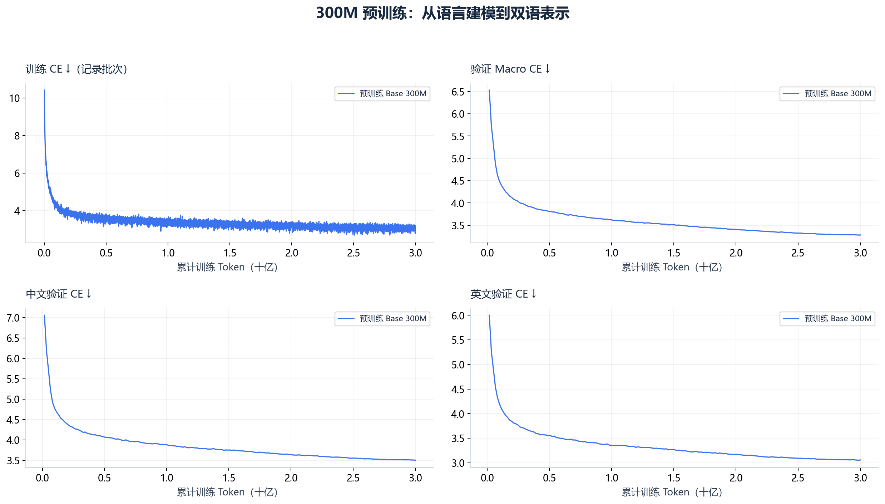
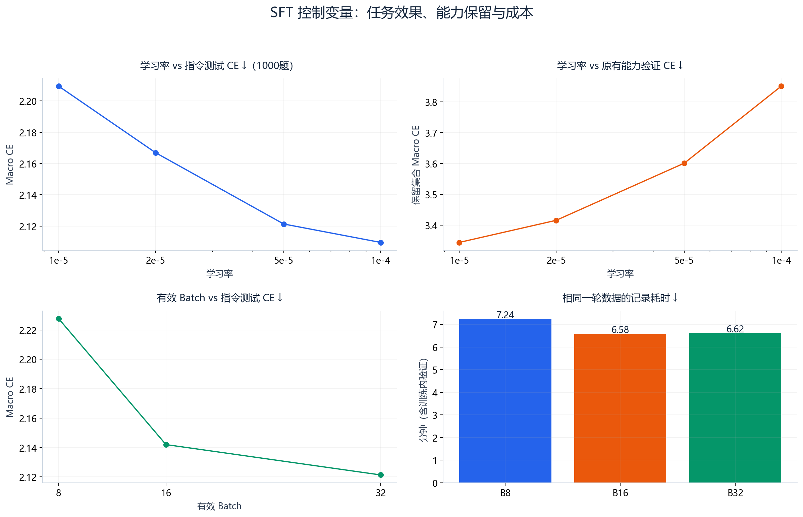
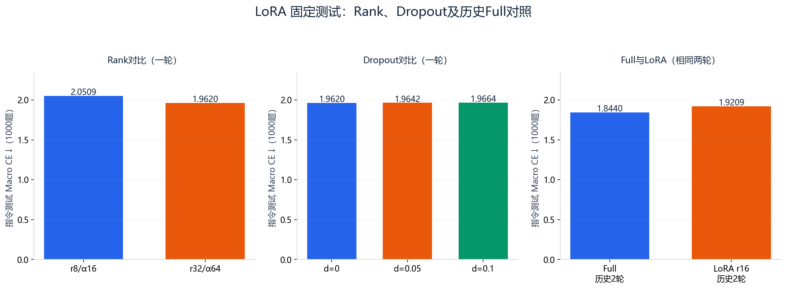
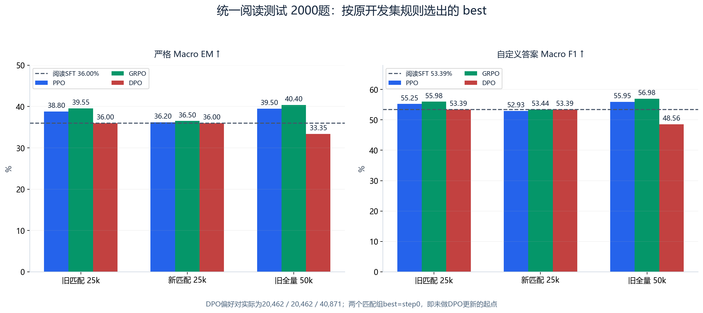
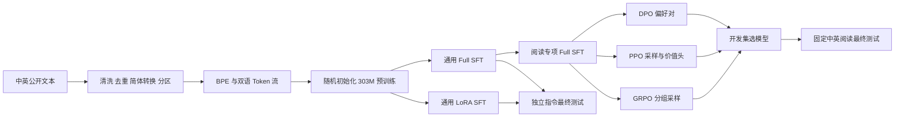

# 中英大模型训练实验室

**单卡完成从随机初始化预训练，到 SFT、LoRA、DPO、PPO 和 GRPO 的可追溯实验。** 主线是自研 **303M Dense Decoder-only Transformer**；本地 Windows 开发和 CPU 验证，远程 Linux / NVIDIA vGPU 48 GB 训练。

项目关注小模型如何学会语言、不同后训练方法改变了什么，以及怎样用独立评测、冻结身份和运行记录检验结果。研究结果有明确能力边界，不把阅读理解分数解释为通用推理能力。

**阅读入口：** [详细实验结果](docs/experiment-results.md) · [架构与源码](docs/architecture.md) · [文档索引](docs/README.md) · [运行手册](docs/remote-runbook.md)

## 已完成的实验

| 阶段 | 实际完成内容 | 关键结果 |
| --- | --- | --- |
| 预训练 | 约 100M / 1B Token 学习实验；303M / 3B Token 正式实验 | 303M 实际参数 **303,350,784**，累计处理 **3,000,008,704 Token** |
| 全参数 SFT | 学习率、Batch、历史轮数对照，100k 数据扩展 | 1,000 题通用指令最终测试回答 CE **1.843989** |
| LoRA SFT | 历史学习率候选筛选，r16 胜出组完成；单轮 rank / alpha / dropout 对照；Adapter 保存与恢复 | 单轮 r32 / alpha64 / dropout0 的测试 CE **1.961969** |
| 阅读专项 SFT | 50k 中英抽取式阅读问答，作为 RL 的共同起点 | 独立阅读测试 Macro EM **36.00%** |
| 偏好与 RL | 三种数据条件 × DPO / PPO / GRPO，共 9 组 | 旧 50k 条件下 PPO **39.50%**、GRPO **40.40%** Macro EM；DPO 未带来提升 |
| 工程 | 数据审计、冻结配置、断点恢复、预算与 GPU 锁、W&B / TensorBoard、独立评测、本地图表 | 数据、Tokenizer、Base、源码和运行身份可追踪 |

评测快照截至 **2026-11-04**，仓库整理日期 **2026-11-13**。CE、EM 和 F1 衡量不同对象，不能直接比较数值大小。完整逐语言结果、Checkpoint 选择规则和来源哈希见[实验报告](docs/experiment-results.md)。

## 实验结果

### 303M 预训练与吞吐

| 项目 | 配置 / 结果 |
| --- | --- |
| 模型 | 24 层，hidden 1024，FFN 2816，16 个 Query 头 / 4 个 KV 头 |
| 词表 / 上下文 | 自训 Byte-level BPE，32,000 / 1,024 Token |
| 组件 | RMSNorm、RoPE、SwiGLU、GQA、输入输出 Embedding 权重绑定 |
| 优化 | AdamW，峰值 LR 3e-4，Warmup 1,500 步，Cosine Decay，梯度裁剪 1.0 |
| 正式 Batch | micro batch 8 × 梯度累积 4；每次更新 32,768 Token |
| 训练量 | 91,553 次更新，3,000,008,704 个处理 Token |
| 语言配比 | 每次更新按有效 Token 中英文各半；中文转简体 |
| 精度与设备 | BF16 autocast；NVIDIA vGPU 48 GB × 1；未确认底层物理型号 |
| 记录时间 | 训练记录累计约 26.96 小时，不是完整云实例计费时间 |

相同模型、相同有效 Token / 更新的受限 GPU 短测：

| micro batch × 累积 | 激活重算 | 稳态 Token/s | 峰值 allocated / reserved |
| --- | --- | ---: | ---: |
| **8 × 4** | 关闭 | **31,674** | **19.65 / 20.72 GiB** |
| 16 × 2 | 关闭 | 27,371 | 33.82 / 35.56 GiB |
| 16 × 2 | 开启 | 21,351 | 12.25 / 14.74 GiB |

因此选择 8×4；显存占用更高并不意味着更快。这是短窗口测速，不是质量对照或通用硬件结论。预训练随机有放回采样，处理 3B Token 不等于无重复覆盖 3B 独立 Token。详见[数据指南](docs/data-guide.md)和[实验结果](docs/experiment-results.md)。



### 全参数 SFT 与 LoRA

下表使用相同的 **1,000 题通用指令最终测试**。CE 仅在回答 Token 上计算，按语言宏平均，越低越好；它不是任务准确率，也不直接证明答案正确。

| 模型 | 训练样本 | 实际训练量 | 学习率 | 测试 Macro CE ↓ |
| --- | ---: | --- | --- | ---: |
| Full SFT 100k | 100,000 | **历史 2 轮** | 5e-5 | **1.843989** |
| LoRA r16 / alpha32 | 100,000 | **历史 2 轮** | 2e-4 | 1.920930 |
| LoRA r8 / alpha16 / dropout0 | 100,000 | 1 轮 | 2e-4 | 2.050936 |
| LoRA r32 / alpha64 / dropout0 | 100,000 | 1 轮 | 2e-4 | **1.961969** |
| LoRA r32 / alpha64 / dropout0.05 | 100,000 | 1 轮 | 2e-4 | 1.964213 |
| LoRA r32 / alpha64 / dropout0.1 | 100,000 | 1 轮 | 2e-4 | 1.966444 |

在这组**单轮 LoRA 对照**中，r32 的 CE 低于 r8，dropout 未改善 CE；ROUGE / EOS 等指标的排序并不完全相同。Full 与历史 r16 的数据、Base 一致，但学习率不同；它们与单轮组训练量也不同，不能据此断言方法在等预算下的普遍优劣。

历史 r16 的另两组学习率候选暂停，未当作完整正式结果；表中只列实际完成且有统一最终评测的组。

历史全参数 SFT 还完成了 LR `1e-5 / 2e-5 / 5e-5 / 1e-4`、有效 Batch `8 / 16 / 32` 和训练量对照。更低指令 Loss 可能伴随原语料保持能力退化，因此同时记录 retention Loss。逐组步数、验证 Loss、测试 CE 和生成统计见[详细表格](docs/experiment-results.md)。





### DPO、PPO、GRPO 九组对照

三种算法从**同一阅读专项全参数 SFT Checkpoint**独立开始，训练题各遍历 **1 轮**；PPO 每批 rollout 做 **2 次内部优化**，GRPO 每题采样 4 个回答。PPO / GRPO 使用可验证的答案匹配奖励，没有额外训练神经 Reward Model。

固定测试含中文 1,000 题、英文 1,000 题。Macro EM 是两种语言严格答案匹配率的平均值，越高越好。表中统一报告按开发集规则选出的 **best**，不根据最终测试重选。

| 训练条件 | DPO best EM ↑ | PPO best EM ↑ | GRPO best EM ↑ |
| --- | ---: | ---: | ---: |
| 旧数据 matched，约 25k prompt | 36.00% | 38.80% | 39.55% |
| 新独立数据 matched，约 25k prompt | 36.00% | 36.20% | 36.50% |
| 旧数据 full，50k prompt | 33.35% | 39.50% | **40.40%** |

共同初始 SFT 为 **36.00%**。GRPO 旧 50k 提高 **4.40 个百分点**；其 last 测试 EM 41.20% 仅作诊断，不用最终测试替换 best。matched DPO 的 best 均为 step 0，训练未超过起点；last 分别退化至 30.40% 和 19.75%。筛选后 DPO 实际偏好对数为 20,462 / 20,462 / 40,871。

旧数据与专项 SFT 有 prompt 复用，新数据采用独立来源，难度和 Token 长度不同；算法的采样和更新开销也不同。这是条件化实验，**并非严格等算力的算法排行榜**。完整逐语言 EM / F1、best / last、统计与负面结果见[报告](docs/experiment-results.md)。



## 架构与目录



```text
configs/        数据、预训练、后训练模板与部署示例
src/
  llm_lab/      Decoder、Tokenizer、预训练、数据、监控与预算
  llm_sft/      全参数 SFT、回答 Loss Mask、完整状态保存
  llm_lora/     PEFT 低层注入、冻结校验、Adapter 训练/评测/恢复
  llm_rl/       DPO、PPO、GRPO，采样、评分、价值头与评测
  llm_align/    阅读/数学专项 SFT 数据与训练衔接
  llm_reading_data/         阅读数据构建、审计、奖励验证
  llm_reading_independent/  新来源隔离、matched 条件构建
  llm_math_data/ / llm_math_public/  数学候选、审核与校准
scripts/        prepare / check / start / resume 及评测入口
tests/          CPU 目标函数、数据隔离、状态与恢复检查
examples/       原创双语 fixture，不含下载语料
docs/           架构、详细结果、数据与运行文档
```

`data/ artifacts/ runs/ tmp/` 为本地或远程产物，不随 Git 发布。正式实验留在 `runs/` 根目录，名称含参数与时间戳；助手短测与诊断进入 `runs/assistant/`。历史冻结身份不因整理改写，见[运行手册](docs/remote-runbook.md)。

## 安装与最小验证

### CPU 离线 fixture

支持 Python **3.10 / 3.11**。Linux 项目根目录执行，无须真实语料、GPU、W&B 登录或模型下载：

```bash
python3 -m venv .venv
source .venv/bin/activate
export TMPDIR="$PWD/tmp" TEMP="$PWD/tmp" TMP="$PWD/tmp"
export PIP_CACHE_DIR="$PWD/.cache/pip"
mkdir -p "$TMPDIR"
python -m pip install -e '.[dev]'
python -m llm_lab.data.acquire --config configs/data/acquire_smoke.json
python -m llm_lab.data.prepare --config configs/data/prepare_smoke.json
python -m llm_lab.cli pretrain --config configs/pretrain/smoke.json --validate-only
python -m llm_lab.cli pretrain --config configs/pretrain/smoke.json \
  --output-dir "runs/assistant/smoke/readme_$(date +%Y%m%d_%H%M%S)"
```

这是 **4 步微型 CPU 检查**，不用于语言质量评估。`examples/_outputs/` 允许重建；正式数据默认拒绝覆盖。已有 PyTorch 环境可先检查版本，不要为此替换既有 CUDA。

Windows PowerShell 可复用自己的 Python 环境：

```powershell
$env:TEMP='E:\codex\tmp'
$env:TMP='E:\codex\tmp'
$env:PYTHONDONTWRITEBYTECODE='1'
$env:PYTHONUTF8='1'
$env:PYTHONIOENCODING='utf-8'
New-Item -ItemType Directory -Force $env:TEMP | Out-Null
python -m pip install -e '.[dev]'
python -m llm_lab.data.acquire --config configs/data/acquire_smoke.json
python -m llm_lab.data.prepare --config configs/data/prepare_smoke.json
python -m llm_lab.cli pretrain --config configs/pretrain/smoke.json --validate-only
```

### 远程 GPU 依赖

正式训练面向 Linux；GPU 锁、`/proc` 检查和队列含 Linux 专用实现。

| 组件 | 历史远程直接依赖版本 |
| --- | --- |
| Python / OS | 3.10 / Ubuntu 22.04 |
| PyTorch | 2.9.0，CUDA 12.8 wheel |
| NumPy / Tokenizers | 1.26.4 / 0.22.2 |
| Transformers / PEFT | 4.57.1 / 0.17.1 |
| TRL / Accelerate | 0.24.0 / 1.11.0 |
| Datasets / OpenCC | 4.3.0 / 1.4.2 |
| W&B / TensorBoard | 0.30.0 / 2.20.0 |

版本见 `requirements/remote.txt`，不是跨平台完整锁文件。自研训练循环使用 PyTorch，LoRA 用 PEFT 低层注入，DPO/PPO/GRPO 在 `llm_rl` 实现。保留的 Transformers / TRL / Qwen 工作流属于早期可选路线，**不是上述结果来源**。

```bash
# 远程项目目录；先进入平台提供的 Python 3.10/3.11 环境。
source scripts/env_remote.sh
bash scripts/setup_remote.sh --install
```

脚本在新 `.venv` 显式安装并执行 GPU 探针，不修改驱动和系统 Toolkit；省略 `--install` 只检查。驱动、镜像 Toolkit 和 PyTorch wheel 中的运行库是三个不同层次，不能仅凭镜像 CUDA 版本判断兼容。

## 正式训练入口

**仅 clone 代码不能直接复现历史长跑。** 需要取得匹配的 manifest、Tokenizer、Base 和运行身份；部分高层启动器还固定了原始输入的 SHA，不能仅改模板路径就用于任意新语料。新数据实验与历史受限入口的区别见[运行手册](docs/remote-runbook.md)。语料、完整预测与模型权重不分发。

### 预训练

下面的高层启动流程要求持有通过原身份校验的 3B 产物；`train_300m.py` 的固定输入约束不会因更换模板而解除。

```bash
source scripts/env_remote.sh
.venv/bin/python scripts/train_300m.py prepare \
  --template configs/pretrain/300m_3b_optimized.json
# 换成 prepare 返回的 .env 路径。
source runs/configs/pretrain_300m_3b_YYYYmmdd_HHMMSS.env
.venv/bin/python scripts/train_300m.py check --config "$RUN_CONFIG"
.venv/bin/python -u scripts/train_300m.py probe --config "$RUN_CONFIG" --steps 32
# probe 已保存进度，继续原总调度，使用 resume。
nohup .venv/bin/python -u scripts/train_300m.py resume --config "$RUN_CONFIG" \
  >> "$RUN_LOG" 2>&1 < /dev/null &
echo "训练 PID: $!"
tail -f "$RUN_LOG"
```

不要将 `max_steps` 改成 32 后当作正式断点恢复。`tail` 中 `Ctrl+C` 仅停止查看；前台训练进程中的 `Ctrl+C` 会停止训练。正常停止用 `kill -INT PID`，等待 Checkpoint / summary 保存；恢复沿用原 `.env` 和 `last.pt`。

### SFT 与 LoRA

先按[数据指南](docs/data-guide.md)准备并验收输入。模板中的历史 Base / manifest 路径、哈希须与实际输入一致，再 prepare；不要改写已冻结的 `runs/configs/`。专项阅读入口另有固定起点约束，见[运行手册](docs/remote-runbook.md)。

```bash
.venv/bin/python scripts/train_sft.py prepare \
  --template configs/posttrain/custom_300m_sft.json
.venv/bin/python scripts/train_lora_one_epoch.py prepare \
  --template configs/posttrain/custom_300m_lora_r8_one_epoch.json
```

两者分别生成独立身份，不启动训练。取得配置后执行相应入口的 `check --config ...`，再显式 `start --config ...`；中断后 `resume`。单卡仅允许一组训练持锁运行。

**后续新实验统一 `epochs=1`、`stop_epochs=null`。** 历史 2/3 轮结果仅用于解释既有实验，不能将旧多轮计划作为新默认。Batch 对照按同一轮样本量计算更新步数。

### DPO / PPO / GRPO

`scripts/train_reading_rl.py` 需要专项 SFT 起点、审计通过的 comparison plan、数据 arm 和 GPU 奖励/数值校准；DPO 另需筛选后的 preference manifest。细节见[数据指南](docs/data-guide.md)和[运行手册](docs/remote-runbook.md)。

```bash
.venv/bin/python scripts/train_reading_rl.py --help
# 已 prepare 且身份匹配后，替换为自己的配置及日志路径：
.venv/bin/python scripts/train_reading_rl.py check --config /path/to/frozen_config.json
nohup .venv/bin/python -u scripts/train_reading_rl.py start \
  --config /path/to/frozen_config.json >> /path/to/run.log 2>&1 < /dev/null &
# 恢复使用同一配置，将 start 替换为 resume。
```

没有正确奖励或 GRPO 组内差异时先校准任务与起点。数学候选虽做过准备和校准，**没有产出本文九组数学 RL 结果**；上述九组是抽取式阅读问答。

## 评测、监控与恢复

- **监控**：JSONL、TensorBoard 和 W&B；可离线记录后同步。API Key 通过登录提示或环境配置注入，不进入 Git。
- **帐号**：部分历史 RL / 网络工具绑定原 W&B entity。新配置须覆盖 `train.wandb_entity`，或设 `null` 使用当前帐号；不要直接运行面向原项目的发布/同步辅助脚本。
- **恢复**：校验 Base、数据、Tokenizer、源码/环境、配置身份，恢复 optimizer / scheduler / RNG 和适用的 GradScaler。日志不等于 Checkpoint。
- **预算**：模板保留原研究单价与 500 元预算校验，需按自己的条件审查。进程估费不覆盖全部空闲/存储费用，训练退出不会释放实例。
- **评测纪律**：开发集选型，最终测试报告。历史早期主测试曾参与选型，不能宣称整个项目从未用测试选模型；后续独立辅助最终测试和阅读测试分别报告。

推理入口：`llm_lab.cli generate`（Base 续写）、`scripts/chat_sft.py`（指令模型）、`scripts/chat_reading_rl.py`（阅读 RL 模型），需对应 manifest / Tokenizer。见[运行手册](docs/remote-runbook.md)。

## 本次验证与能力边界

```bash
python -m pytest -q -p no:cacheprovider --basetemp tmp/pytest
```

2026-11-13 发布检查在现有 Windows 环境运行全套：**648 passed、8 failed、7 skipped、4 errors**。8 个失败与缺 PEFT 0.17.1 有关，4 个错误来自缺 OpenCC；跳过项涉及 PyArrow、Transformers 版本和 POSIX 平台。当前环境不同于历史远程固定组合，**不能标为全套通过**。离线 acquire → prepare → 配置校验 → 4 步 CPU 训练 → 生成 → validation 评测已单独通过。原始检查记录保存在未提交的 `runs/assistant/system/release_20261113/`；本轮仅精简文档，没有重跑训练。

CPU fixture 不证明 GPU 数值与吞吐；单 seed 不证明跨种子显著性。仓库未实现 FSDP / ZeRO / MoE、生产推理服务或通用数学推理 RL。详细结果报告保留负面结果和比较局限。

## 数据、许可与发布范围

公开仓库包含源码、配置模板、原创 fixture、文档和脱敏汇总图表；不分发真实语料、模型/Adapter 权重、完整样本预测、W&B 原始事件、缓存或 SSH 登录配置。

预训练来源含 Wikipedia、FineWeb-2 / FineWeb-Edu，通用 SFT 和阅读数据来源、固定版本、筛选与许可统一见[数据指南](docs/data-guide.md)。存在署名、共享、非商业等不同许可，**混合数据不能统一视为可商用**。代码依赖、原始数据和模型分发需分别核对；本次未擅自指定覆盖全仓的开源许可证。

`.gitignore` 排除了运行产物、凭据、机器配置和个人面试交付包。连接模板见 [sync_autodl.example.json](configs/deployment/sync_autodl.example.json)、[wandb_network.example.json](configs/remote/wandb_network.example.json)。部署打包脚本不遵循 Git 发布筛选，不可直接将本地部署包公开；`.gitattributes` 保留冻结源码与结果文件原始字节，避免换行转换破坏 SHA 身份。

`docs/` 仅保留 5 份核心文档及 `results/`。历史计划、操作流水、教学和面试资料已转入 Git 忽略的 `artifacts/document_archive/`，并保留逐文件校验与旧新路径映射；公开历史版本也可从 Git 提交记录查阅。
