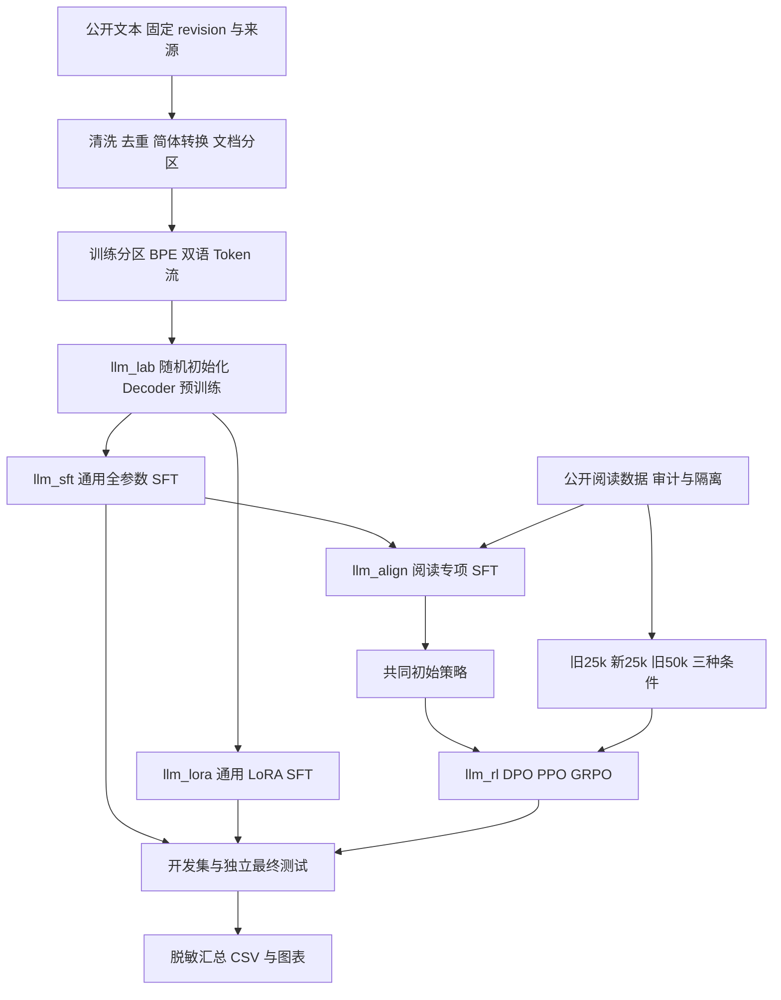

# 架构与源码入口

本文描述截至 2026-11-13 的实际主线。早期 Qwen2.5-0.5B / MASSIVE 工作流仍保留在源码中，属于可选历史路线；本项目已完成的 303M、SFT、LoRA 和九组阅读 RL 结果来自下面的自研模型链路。

## 数据流与模块

| 模块 | 核心文件 | 职责 |
| --- | --- | --- |
| 模型 | [decoder.py](../src/llm_lab/models/decoder.py) | RMSNorm / RoPE / GQA / SwiGLU、绑定 Embedding；不负责下载或状态持久化 |
| 预训练数据 | [data/](../src/llm_lab/data/)、[tokenization/](../src/llm_lab/tokenization/) | 获取、过滤、去重、分区、BPE、双语 Token 流与 manifest |
| 预训练引擎 | [pretrain.py](../src/llm_lab/engine/pretrain.py)、[corpus.py](../src/llm_lab/engine/corpus.py) | 随机窗口采样、语言配比、混合精度、梯度累积、优化与评测 |
| 训练状态 | [checkpoint.py](../src/llm_lab/engine/checkpoint.py)、[repro.py](../src/llm_lab/common/repro.py) | 权重、optimizer、scheduler 所需进度、RNG、GradScaler 与身份校验 |
| 全参数 SFT | [llm_sft/](../src/llm_sft/) | 消息模板、回答区间 Loss Mask、训练 / 保持能力评测、恢复 |
| LoRA | [adapters.py](../src/llm_lora/adapters.py)、[engine.py](../src/llm_lora/engine.py) | PEFT 低层注入、目标层覆盖与冻结检查、adapter 保存恢复 |
| 阅读数据 | [llm_reading_data/](../src/llm_reading_data/)、[llm_reading_independent/](../src/llm_reading_independent/) | 跨分区/来源隔离、简体转换、答案跨度、独立来源及 matched 视图 |
| 专项 SFT | [full_sft.py](../src/llm_align/full_sft.py)、[reading_rl_data.py](../src/llm_align/reading_rl_data.py) | 自研模型到抽取式阅读任务的训练衔接 |
| RL 目标 | [objectives.py](../src/llm_rl/objectives.py) | DPO、PPO clipped policy / value 目标、GRPO 分组优势与 KL |
| RL 执行 | [engine.py](../src/llm_rl/engine.py)、[generation.py](../src/llm_rl/generation.py)、[scoring.py](../src/llm_rl/scoring.py) | 在线采样、actor / reference 打分、PPO 价值头、更新与持久化 |
| 阅读评测 | [evaluation.py](../src/llm_rl/evaluation.py)、[verifier.py](../src/llm_reading_data/verifier.py) | 固定规则的答案 EM / F1 和开发集评测 |
| 监控 / 预算 | [tracking.py](../src/llm_lab/common/tracking.py)、[budget.py](../src/llm_lab/common/budget.py) | JSONL / W&B / TensorBoard、进程估费、共享项目账本 |
| 入口 | [scripts/](../scripts/) | 显式 prepare / check / start / resume、单卡互斥、环境与身份检查 |

数学相关包保存候选构建、质量审核和校准功能，不应与已经完成的阅读 RL 实验混淆。

## 模型边界

主模型参数为 303,350,784，24 层、hidden 1024、FFN 2816、16 个 Q 头 / 4 个 KV 头、词表 32,000、上下文 1,024。训练使用 PyTorch SDPA，源码将 KV 扩展后计算；不能宣称实现了独立 FlashAttention 内核或原生无扩展 GQA。

预训练续写 CLI 每步重算窗口；后续 RL 使用独立的推理 KV 适配器。两者是不同路径，不能把后者的缓存收益当作所有入口都支持 KV cache。

LoRA 复用 PEFT 的低层注入，本项目负责自研模型适配、冻结与覆盖检查、训练和完整恢复；并非从零重写所有低秩模块。PPO 的 critic 是独立线性价值头，输入来自 detach 的 actor 特征，不是额外一整个 300M critic 模型。DPO 使用离线偏好对；PPO / GRPO 使用规则可验证奖励，未单独训练神经 Reward Model。

## 输入、运行身份与恢复

1. 数据发布生成 manifest、分区文件、Tokenizer、哈希及验收报告。
2. `prepare` 从模板生成带参数和时间戳的新配置，绑定输入与源码身份；本步骤不启动训练。
3. `check` 在执行前检查文件、SHA、预算、空闲空间及适用的 GPU 条件。
4. `start` 创建新输出；`resume` 使用同一输出目录的 `last.pt` 继续原计划。
5. `best.pt` 按开发/验证规则选择，最终测试用于报告，不反向替换选型结果。

改变数据、Base、Tokenizer、关键源码或调度应另建运行。历史冻结配置可能绑定旧源码或远程绝对路径，仅凭公共 checkout 不保证恢复成功；不能为了“能恢复”而删除身份校验。原子保存降低半文件风险，不能替代持久磁盘备份。

新建后训练实验固定 `epochs=1`、`stop_epochs=null`，学习率调度按一轮总步数建立。历史 2/3 轮与停止点保持原样；恢复只完成原定剩余量。预训练仍按明确的处理 Token / 更新预算定义，不将随机采样误写为完整遍历语料。

## 运行目录与公开仓库

- `runs/<参数与时间戳>/`：用户正式实验，保存权重、指标和运行身份。
- `runs/configs/`：冻结配置及环境指针；`runs/budget_ledger.json` 和 `.gpu_training.lock` 保持既有身份。
- `runs/assistant/{smoke,benchmarks,inference,data_prepare,system}/`：助手检查、测速和诊断。
- `data/` 与 `artifacts/`：来源缓存、数据发布与验收；不进入 Git。
- `docs/results/`：公开的脱敏指标、来源哈希和图表；不是完整原始数据备份。

不为整理目录移动冻结输入或改写历史 JSON 的绝对路径。Git 发布排除机器连接配置、凭据和运行目录；部署打包器有单独白名单，不能假设它自动遵循 `.gitignore`。

本项目是单卡研究工程，尚未实现分布式训练平台、生产推理服务或 Web 控制台。成本记录是进程估算，训练结束不会自动释放云资源。实际结果和局限见[实验报告](experiment-results.md)。
