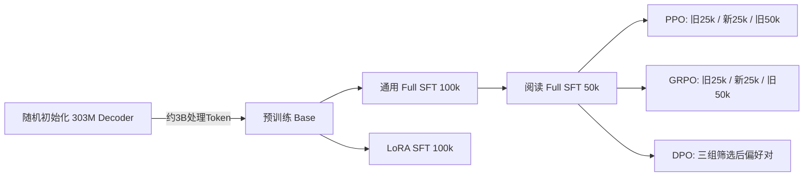
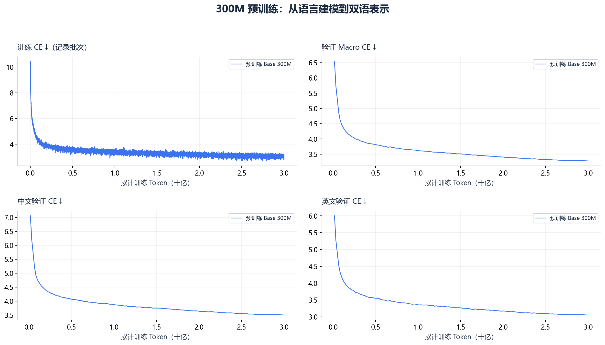
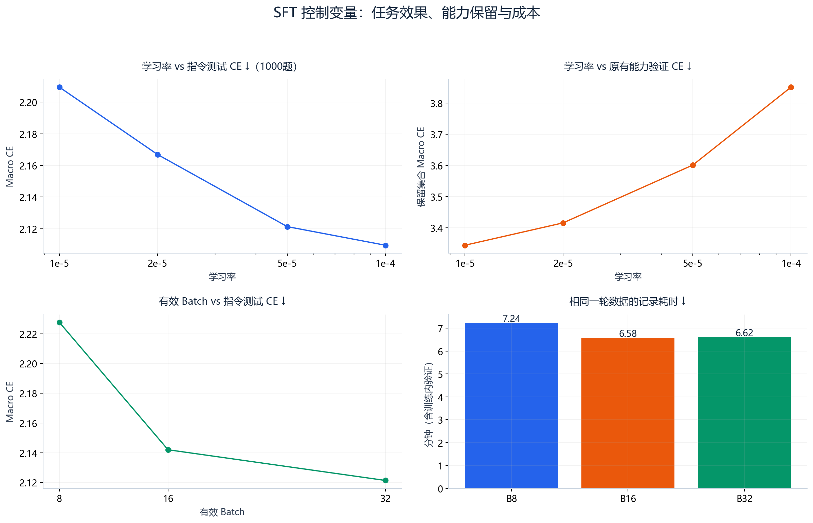
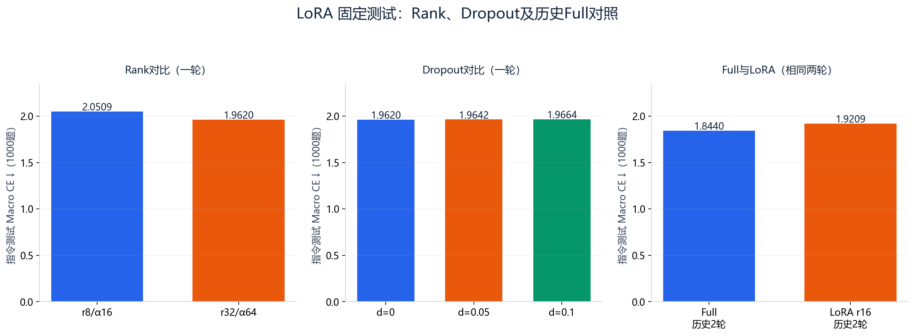
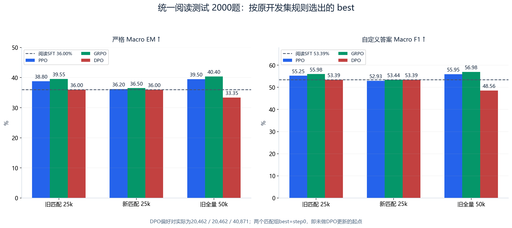
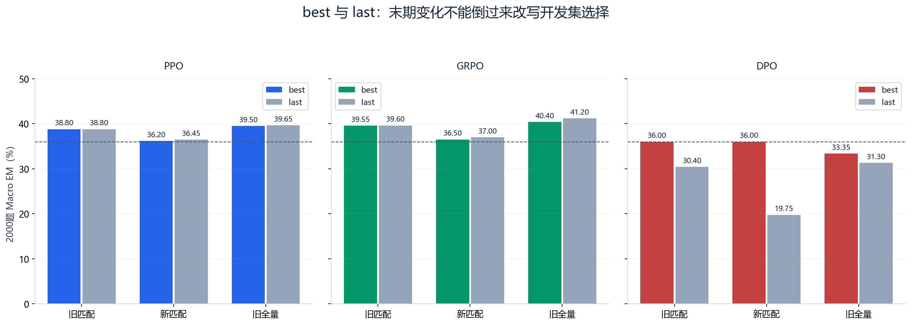

# 实验结果与评测边界

本页于 **2026-11-13** 根据本地保留的冻结配置、训练日志和 **2026-11-04 v3 完整测试结果** 整理。它是历史结果的发布摘要，本次整理没有启动训练或重新评测。图表来自既有日志，CSV保留汇总数值；仓库不发布模型权重、原始语料、完整逐题预测或个人 W&B 配置。

## 1. 已完成什么

主线为自研 **303,350,784 参数 Dense Decoder** 从零预训练，然后分别进行通用全参数 SFT、LoRA SFT，以及阅读领域 SFT 后的 DPO / PPO / GRPO 对照。



LoRA没有作为本轮RL起点。九组RL分别从**同一阅读SFT best**独立初始化，而不是依次接着训练。PPO与GRPO采用可验证的抽取答案奖励，RLVR描述奖励来源，不是第四种独立算法。早期Qwen后训练计划和数学候选数据不代表已完成对应模型实验。

| 已验证结论 | 数值 | 解释范围 |
| --- | ---: | --- |
| 300M预训练完成处理量 | 3,000,008,704 Token / 91,553更新 | 是实际处理量；随机有放回窗口不等于唯一Token覆盖 |
| 通用Full SFT 100k最终指令Macro CE | **1.843989** | 1,000题参考回答建模；历史实际两轮 |
| 历史LoRA r16最终指令Macro CE | 1.920930 | 同Base/同100k/实际两轮，采用不同已选学习率 |
| 新单轮LoRA开发集选型 | r32 / alpha64 / dropout0 | 最终指令CE **1.961969**；不以最终测试重新选型 |
| 阅读SFT 50k最终Macro EM | **36.00%** | 固定中英阅读测试2,000题 |
| PPO旧50k / 开发集best | **39.50%** | 相对阅读SFT +3.50个百分点 |
| GRPO旧50k / 开发集best | **40.40%** | 相对阅读SFT +4.40个百分点，即多正确88题 |
| 匹配DPO两组best | 均为step 0 | 与阅读SFT起点相同，不是DPO学习后的提升 |

这些是当前固定模型、单seed、特定语料和实现上的结果，不是通用聊天、数学推理或算法普遍排名。

## 2. 模型与预训练

| 项目 | 实际设置 |
| --- | --- |
| 模型规模 | 303,350,784参数；24层；hidden=1024；FFN=2816 |
| Attention | 16个Q头、4个KV头、head_dim=64；GQA；RoPE theta=10000 |
| 其他结构 | RMSNorm、SwiGLU、无bias Linear、Embedding与输出层共享 |
| Tokenizer / 上下文 | 本项目BPE；词表32,000；上下文1,024 |
| 实际计算资源 | 单张NVIDIA vGPU-48GB；不把虚拟卡等同已核实的4090 |
| 训练批量 | micro batch 8 × accumulation 4 × context 1024 = 32,768 Token/更新 |
| 优化器与调度 | AdamW，peak LR=3e-4，warmup=1,500步，cosine最低比例0.1，WD=0.1，clip=1.0 |
| 数值与显存 | BF16 autocast，FP32主参数；此轮关闭activation checkpointing |
| 数据 | 中英文有效Token配比各半；中文统一简体；约3.1B训练池 |
| 实际更新与处理量 | 91,553步；3,000,008,704 Token |
| 最低预训练验证Macro CE | **3.279552** |
| 最终验证Macro CE / 中文 / 英文 | 3.281063 / 3.505007 / 3.057120 |
| 最终中文 / 英文PPL | 33.281666 / 21.266219 |
| 记录累计计算时间 | **97,056.25秒，约26.96小时**，包含训练内验证等开销 |
| 记录峰值allocated | 21,159,093,760 bytes，约19.71 GiB；不等于reserved或整卡占用 |
| 训练进程估算费用 | 81.689元，按当时3.03元/小时；不是平台账单 |



源码的Attention先显式扩展KV头，再调用PyTorch SDPA；没有自行实现FlashAttention，也不保证所有设备使用同一高效kernel。预训练的EOS是文档结束标记，连续Token流没有文档级Attention隔离。随机有放回窗口可能重叠，因此3B处理量不是3B独立位置的无重复遍历。

100M / 1B为早期独立实验，不能恢复为300M模型。本地发布快照缺少其完整训练轨迹，故不补画曲线或补估结果；本页的定量训练与后训练结论以证据完整的300M主线为准。

## 3. 测试设计和指标

### 3.1 三套用途不同的集合

| 集合 | 规模与组成 | 使用方式 |
| --- | --- | --- |
| 历史通用主测试 | 1,000条，中文660、英文340；中英回答监督Token近似各半 | 曾用于选择SFT配置；每模型仅抽64条生成，另有完整1,000条CE |
| 统一通用指令最终测试 | 1,000条，中文743、英文257；回答Token约各50% | 所列15个模型完整生成；改写235、摘要235、材料问答177、格式177、一般问答176 |
| 阅读最终测试 | 中文1,000 + 英文1,000；DRCD500、CMRC2018 500、SQuAD1,000 | 所列22个模型/Checkpoint条目完整生成；与训练精确问题、材料和已知文章组隔离 |
| LoRA选型开发集 | 独立辅助开发集2,000条 | 单轮终点选rank/dropout；每组内部best另按主验证保存 |
| RL共同开发集 | 固定256题 | 按中英Macro EM选best，F1用于同分区分；初始EM=26.953125% |

历史主测试、历史扩充辅助测试和统一最终测试不是同一分布，CE绝对值不能跨表直接比较。最终指令测试在LoRA新rank/dropout选型前冻结，但此前历史结果已向开发者展示；不能证明所有人工决策完全不受已见结果影响。

阅读最终测试包含230个文章分组、840份规范化材料；英文1,000题仅有20个文章分组，中文1,000题210组。独立信息量明显小于把2,000道题完全视为独立样本的假设。

### 3.2 计算口径

- **Macro CE**：提示与PAD屏蔽，仅参考回答和EOS参与交叉熵；先按每种语言的真实监督Token汇总，再对中英文等权平均。低CE表示更容易拟合参考分布，不等于生成正确率。
- **Macro EM**：按声明规则规范化答案后，与任一金标准别名完整匹配；中英文等权。本次阅读两种语言各1,000题，因此也等于总正确数/2,000。
- **Macro F1**：项目自定义中文字符/词片段、英文空白分词重合指标；不是官方SQuAD/CMRC排行榜分数，也不是语义裁判。
- **ROUGE-L**：参考文本重合；同时披露语言等权和总体口径。EOS率、输出长度、重复3-gram比例是行为诊断，不能直接当作答案质量。
- **统计区间**：阅读采用同题配对、语言分层、文章整群bootstrap 2,000次；95%区间未校正同时比较。另有九个best对SFT的McNemar Holm校正及探索性文章整组检验。区间不包含训练seed和选型不确定性。

### 3.3 推理与复用

正式评测在单张vGPU-48GB上使用CUDA BF16、eval、贪心生成、seed42、无重复惩罚。阅读最多64新Token、生成Batch16；指令最多256新Token、Batch128，仅禁止PAD/UNK。CE用原Decoder原生前向，微批8；生成使用独立只读KV适配器。

BF16批次和缓存kernel不保证逐位一致。全部正式排名使用统一协议，历史原生生成另列；34次实际模型×集合计算的缓存prefill诊断最大相对L2约2.748%，少量探针存在首16 Token差异。不同文件中模型张量摘要相同且评测协议相同时复用结果，并保留逻辑条目。

本次共有**37个逻辑模型×集合条目、59,000个逻辑题次，但只有3,000道唯一测试题**；补充10,000条跨域CE仍使用原指令1,000题。不能把模型间重复评测题次当作新增独立测试样本。

## 4. 全参数SFT控制变量结果

### 4.1 约20k单轮学习率与Batch

共同条件：同一预训练Base；19,991训练、995验证；micro batch=8；BF16；seed42。以下CE/ROUGE/EOS均来自**统一最终指令1,000题**；保持CE来自历史固定预训练验证小窗口。

| LR | 有效Batch | 累积 | 实际轮数 | 终点/所测best步数 | 指令Macro CE↓ | Macro ROUGE-L↑ | EOS↑ | 保持CE↓ |
| --- | ---: | ---: | ---: | ---: | ---: | ---: | ---: | ---: |
| 1e-5 | 32 | 4 | 1 | 625 / 625 | 2.209506 | 0.1988 | 73.00% | 3.343713 |
| 2e-5 | 32 | 4 | 1 | 625 / 625 | 2.166935 | 0.2039 | 76.30% | 3.415600 |
| 5e-5 | 32 | 4 | 1 | 625 / 625 | 2.121322 | 0.2132 | 80.20% | 3.601429 |
| 1e-4 | 32 | 4 | 1 | 625 / 625 | 2.109537 | 0.2210 | 83.60% | 3.851598 |
| 5e-5 | 16 | 2 | 1 | 1,250 / 1,250 | 2.141977 | 0.2170 | 80.60% | 3.801644 |
| 5e-5 | 8 | 1 | 1 | 2,499 / 2,499 | 2.227718 | 0.2189 | 80.50% | 4.126322 |



在本次单轮预算下，较大学习率更快适应参考答案分布，同时保持CE上升；不能仅按任务CE说越大越好。同一轮题量下B8/16/32更新次数不同，属于等数据量比较，不是等更新次数或等Token的严格比较。记录计算时间分别约7.24/6.58/6.62分钟；这是本实现的进程记录，不能当作显卡通用性能。

### 4.2 历史轮数和100k扩充

| 模型 | 训练题数 | 历史实际轮数 | 最终更新 | 所测best | 统一最终指令CE | Macro ROUGE-L | EOS |
| --- | ---: | ---: | ---: | ---: | ---: | ---: | ---: |
| 预训练Base | — | — | 91,553 | 历史best | 2.508236 | 0.1289 | 1.80% |
| SFT20k，LR5e-5/B32 | 19,991 | 1 | 625 | 625 | 2.121322 | 0.2132 | 80.20% |
| SFT20k，两轮停止 | 19,991 | 2 | 1,250 | 1,250 | 2.092447 | 0.2359 | 80.80% |
| SFT20k，三轮预算 | 19,991 | 3 | 1,875 | **1,200** | 2.097498 | 0.2348 | 84.40% |
| Full SFT100k | 100,000 | **2** | 6,250 | 6,250 | **1.843989** | 0.3411 | 86.00% |

历史两轮停止使用共享三轮调度，三轮组的best又早于终点，因此不能把表中差异纯粹归因于epochs。历史主测试曾用于选定两轮方案，该集合已经是选型依据；它的原CE为2.041807，与本表统一最终测试CE口径的样本分布不同。

旧选定20k模型与100k模型在扩充阶段另做过辅助1,000题CE（2.147776 → 1.894619）和64条生成；原历史主测试CE则2.041807 → 2.076229。数据量、任务构成和长度同时变化，并非只增加条数。100k扩充后固定保持窗口CE约4.924127，相对Base历史约3.265532变差，说明存在分布保持代价。

**所有后续新实验保持epochs=1，stop_epochs省略或null；本页只记录历史多轮事实，不把旧调度当新模板。**

## 5. LoRA：rank、dropout和全参数对照

LoRA通过PEFT的低层Adapter注入接口接入自研Decoder，项目负责层覆盖检查、冻结、训练循环、保存、恢复和推理组合；不是自行重新实现PEFT全部低秩算子。目标为Attention q/k/v/out与MLP gate/up/down共168个Linear层。

新四组固定同一Base、100k训练集、LR2e-4、B32、3,125更新、**真正一轮调度**。r8/alpha16与r32/alpha64保持alpha/r=2；先按独立开发集终点选rank，再比较固定rank的dropout。每组主验证best和开发终点排名分别记录。

| 配置 | 可训练Adapter参数 | 占Base比例 | 独立开发CE↓ | 主验证CE↓ | 最终指令CE↓ | Macro ROUGE-L↑ | EOS↑ |
| --- | ---: | ---: | ---: | ---: | ---: | ---: | ---: |
| r8 / alpha16 / dropout0 | 3,489,792 | 1.15% | 2.0837 | 2.2797 | 2.050936 | 0.2982 | 89.70% |
| **r32 / alpha64 / dropout0** | 13,959,168 | 4.60% | **1.9964** | 2.2055 | **1.961969** | 0.3121 | 89.10% |
| r32 / alpha64 / dropout0.05 | 13,959,168 | 4.60% | 1.9980 | 2.2070 | 1.964213 | 0.3164 | 90.70% |
| r32 / alpha64 / dropout0.1 | 13,959,168 | 4.60% | 2.0001 | 2.2086 | 1.966444 | 0.3161 | 89.80% |



r32相对r8的CE改善明显大于dropout三组之间差距。dropout0.05的ROUGE/EOS并非更差，因此“CE最低”不等于每个行为指标都最好；保留事前开发集选型r32/dropout0，不按最终测试改选。

| 已交付模型 | 实际遍历 | LR | 可训练参数 | 最终CE | 记录分钟 | best / 可恢复last大小MiB |
| --- | ---: | --- | ---: | ---: | ---: | --- |
| Full SFT100k | 历史2轮 | 5e-5 | 303,350,784 | 1.843989 | 56.26 | 1157.27 / 3471.85 |
| 历史LoRA r16/alpha32 | 历史2轮 | 2e-4 | 6,979,584 | 1.920930 | 76.63 | 26.74 / 80.29 |
| 新LoRA r8 | 1轮 | 2e-4 | 3,489,792 | 2.050936 | 39.02 | 13.43 / 40.35 |
| 新LoRA r32/dropout0 | 1轮 | 2e-4 | 13,959,168 | 1.961969 | 37.99 | 53.36 / 160.16 |

历史r16与Full同Base/数据/两轮，使用各自学习率，支持已选方案比较；LoRA−Full CE差为+0.07694，95%逐题配对区间[+0.06062,+0.09273]。新r8/r32与历史Full轮数不同，不构成等预算方法控制实验。少训练参数减少优化器和Checkpoint开销，但本实现历史r16耗时反而更长，不能承诺按参数比例加速。Adapter文件不包含完整Base，重建必须同时持有原Base和Tokenizer身份。

## 6. 阅读专项SFT与RL数据

通用Full100k继续做50,000条阅读全参数SFT，LR5e-5、micro8×accumulation4、context1024、epochs1，完成1,563更新；然后为所有九组RL固定共同起点。其best文件SHA256为：

```text
7b13791c6afb50eeb09db33c750e40e6cab61d9fc26cd08ea2f8aa72ce58eca4
```

| 模型 | 阅读Macro EM | Macro F1 | 阅读回答CE |
| --- | ---: | ---: | ---: |
| 预训练Base | 0.00% | 0.0456 | 3.3070 |
| 通用Full SFT100k | 0.05% | 0.0774 | 3.4809 |
| LoRA r32/dropout0 | 0.05% | 0.1598 | 3.0308 |
| 阅读Full SFT50k | **36.00%** | **0.5339** | **1.0554** |

这显示短回答格式和领域适配的重要性，不证明通用SFT在其他任务无效。

| 数据组 | PPO/GRPO问题数 | DPO合格偏好对 | 来源与是否在领域SFT见过 |
| --- | ---: | ---: | --- |
| old_matched | 25,000 | 20,462 | 旧阅读SFT50k固定子集，明确是已见题对照 |
| new_matched | 25,000 | 20,462 | DuReader-robust与Quoref，已检查问题/材料/已知文章组隔离 |
| old_full_50k | 50,000 | 40,871 | 旧阅读SFT全量，观察样本量/更新量扩展 |

新25k为中文11,336、英文13,664，答案+EOS Token中文占49.50%。DPO不复制样本凑满：匹配组各20,462对，中文8,256、英文12,206，中文答案监督Token占约44.58%/44.71%，不宣称严格50%。

DPO chosen为原人工答案，rejected为**共同初始SFT**离线采样并规则筛选的负例，排除空答、无EOS、特殊Token、疑似别名/包含和高F1重叠。“不是原文跨度”可作为抽取格式负例，但不代表人工证明其语义错误；这些是规则派生偏好，不是人工成对偏好。在线PPO/GRPO使用金标准别名的可验证奖励，没有训练额外完整Reward Model。

## 7. 九组DPO / PPO / GRPO完整结果

### 7.1 配置与实际更新

| 设置 | PPO | GRPO | DPO |
| --- | --- | --- | --- |
| actor LR | 1e-6 | 1e-6 | 5e-6 |
| 每批问题 / 评分反向微批 | 16 / 16 | 16 / 16 | 16 / 16 |
| 每题采样 | 1 | 4 | 初始SFT离线负例 |
| 每批内部优化次数 | **2** | 1 | 1 |
| 数据epochs / stop_epochs | 1 / null | 1 / null | 1 / null |
| 精度 / 上下文 / 最大回答 | BF16 / 1024 / 64 | 同左 | 同左 |
| 特有参数 | clip0.2、KL0.02、GAE gamma1/lambda0.95 | clip0.2、KL0.02、组归一化优势 | beta0.1 |
| 匹配组最终optimizer步 | 3,126 | 1,563 | 1,279 |
| 旧全量最终optimizer步 | 6,250 | 3,125 | 2,555 |

PPO的critic是输入detach actor特征的独立线性value head，LR1e-4、value coefficient0.5、value clip0.2，不是额外完整303M模型。两次内部优化不等于训练数据遍历两轮。GRPO在回答内部对有效Token平均，再对回答等权平均；KL记录定义也与PPO不同，不直接跨算法比KL或loss绝对值。

### 7.2 开发集选定best的最终测试

| 算法 / 数据 | 所测best步 | Macro EM↑ | 中文EM | 英文EM | Macro F1↑ | EOS | 阅读CE↓ |
| --- | ---: | ---: | ---: | ---: | ---: | ---: | ---: |
| 阅读SFT起点 | 1,563 | 36.00% | 39.40% | 32.60% | 0.5339 | 99.70% | 1.0554 |
| PPO / 旧25k | 3,126 | 38.80% | 42.00% | 35.60% | 0.5525 | 99.90% | 1.0800 |
| PPO / 新25k | 1,200 | 36.20% | 40.30% | 32.10% | 0.5293 | 99.85% | 1.0858 |
| PPO / 旧50k | 6,000 | 39.50% | 42.90% | 36.10% | 0.5595 | 99.55% | 1.1018 |
| GRPO / 旧25k | 1,100 | 39.55% | 42.80% | 36.30% | 0.5598 | 99.75% | 1.0716 |
| GRPO / 新25k | 300 | 36.50% | 40.90% | 32.10% | 0.5344 | 99.70% | 1.0636 |
| GRPO / 旧50k | 2,000 | **40.40%** | 43.10% | 37.70% | **0.5698** | 99.85% | 1.0960 |
| DPO / 旧匹配 | **0** | 36.00% | 39.40% | 32.60% | 0.5339 | 99.70% | 1.0554 |
| DPO / 新匹配 | **0** | 36.00% | 39.40% | 32.60% | 0.5339 | 99.70% | 1.0554 |
| DPO / 旧全量 | 1,300 | 33.35% | 37.10% | 29.60% | 0.4856 | 100.00% | 1.4826 |



| 相对阅读SFT | EM变化/百分点 | 描述性95%文章群区间 | 新增正确 / 丢失正确 |
| --- | ---: | --- | --- |
| PPO旧25k | +2.80 | [+1.52,+4.13] | 113 / 57 |
| PPO新25k | +0.20 | [-1.17,+1.68] | 86 / 82 |
| PPO旧50k | +3.50 | [+2.23,+4.80] | 120 / 50 |
| GRPO旧25k | +3.55 | [+2.44,+4.78] | 112 / 41 |
| GRPO新25k | +0.50 | [-0.67,+1.78] | 67 / 57 |
| GRPO旧50k | +4.40 | [+3.18,+5.66] | 133 / 45 |
| DPO旧匹配 / 新匹配 | 0 / 0 | 同起点零差异 | 0 / 0 |
| DPO旧全量 | -2.65 | [-5.01,-0.42] | 152 / 205 |

GRPO旧50k的+4.40是**百分点**，不是相对提高4.40%。这些区间是固定权重下的测试抽样不确定性，不包含训练随机性；DPO旧全量在探索性文章群检验的Holm p约0.164，与题级检验的解释不同，不能只挑有利检验下结论。

### 7.3 best与单轮last

| 算法 / 数据 | best步 → last步 | best EM | last EM | last−best/百分点 | 全轮记录分钟 |
| --- | --- | ---: | ---: | ---: | ---: |
| PPO旧25k | 3,126 → 3,126 | 38.80% | 38.80% | 0 | 49.97 |
| PPO新25k | 1,200 → 3,126 | 36.20% | 36.45% | +0.25 | 46.50 |
| PPO旧50k | 6,000 → 6,250 | 39.50% | 39.65% | +0.15 | 95.27 |
| GRPO旧25k | 1,100 → 1,563 | 39.55% | 39.60% | +0.05 | 72.52 |
| GRPO新25k | 300 → 1,563 | 36.50% | 37.00% | +0.50 | 85.32 |
| GRPO旧50k | 2,000 → 3,125 | 40.40% | **41.20%** | +0.80 | 147.01 |
| DPO旧匹配 | **0** → 1,279 | 36.00% | **30.40%** | -5.60 | 16.85 |
| DPO新匹配 | **0** → 1,279 | 36.00% | **19.75%** | -16.25 | 22.24 |
| DPO旧全量 | 1,300 → 2,555 | 33.35% | 31.30% | -2.05 | 33.57 |



last仅作预先声明的终点诊断，不在看过最终测试后用41.20%替换开发集选出的40.40%。两组匹配DPO的best张量与阅读SFT完全相同，last才反映实际更新后的终点。偏好loss下降或margin扩大未保证EM提升；可能涉及负例格式、答案边界、分布和超参数，尚未通过独立干预确定主因。

旧全量DPO开发best只比初始多对1题（70/256对69/256），而F1下降；按事前“先EM后F1”规则仍会选出step1300，暴露小开发集和字典序选点噪声。epochs1也不能保证无过拟合。

### 7.4 数据方案和能力保持

同样25k题，新组相对旧组的最终best EM：PPO -2.60个百分点，GRPO -3.05个百分点。两者同时改变来源、难度、长度与SFT可见性，最终测试又来自旧来源分布，不能据此说新人工语料质量更差或“复用SFT一定更好”。旧50k相对旧25k还改变了更新量和算力。跨算法PPO两次更新、GRPO四次采样、DPO筛选减量，也不等算力。

在同一通用指令1,000题上的额外保持CE为：Full100k **1.8440**，阅读SFT **2.3406**，GRPO旧50k best **2.3828**。阅读分数上升伴随通用参考分布建模的取舍；该额外检查只算CE，没有对RL全部模型做通用生成语义评审，不能声称全能力同步提高。

## 8. 可复核文件和发布范围

仓库包含下列**无逐题内容的汇总表**，均由保留的v3结果导出；数值保留原浮点精度。字段中的W&B帐号、URL、绝对Checkpoint/机器路径不发布。

| 文件 | 内容 |
| --- | --- |
| [model_inventory.csv](results/model_inventory.csv) | 模型阶段、Base/Checkpoint SHA、数据量、LR/Batch/epoch、更新步、参数与成本 |
| [instruction_1000.csv](results/instruction_1000.csv) | 通用指令15个模型的CE、ROUGE、EOS、重复等汇总 |
| [reading_all_checkpoints.csv](results/reading_all_checkpoints.csv) | 阅读22个best/last/基线条目的汇总 |
| [reading_paired_comparisons.csv](results/reading_paired_comparisons.csv) | 九组best对阅读SFT的配对区间与校正统计 |
| [best_vs_last.csv](results/best_vs_last.csv) | best/last步数、成绩、差值与张量相同标记 |
| [historical_sft_controls.csv](results/historical_sft_controls.csv) | 原历史主测试CE与64条生成诊断，和统一最终测试分开 |
| [cross_domain_instruction_loss.csv](results/cross_domain_instruction_loss.csv) | 阅读SFT与RL best在通用1,000题上的CE保持检查 |
| [provenance.json](results/provenance.json) | 来源相对路径、源文件与发布文件SHA256、图表逐文件校验 |

原始证据在未提交Git的本地目录`runs/assistant/inference/posttrain_comprehensive_20261104_v3/`：`report/完整测试报告.md`、`report/tables/`、`report/report_manifest.json`、`sources_local/training/`和`results_local/`。预训练数据容量另见[data-3b.md](data-3b.md)，LoRA协议见[lora-rank-dropout-20261101.md](lora-rank-dropout-20261101.md)，九组RL协议见[reading-rl-comparison-20261102.md](reading-rl-comparison-20261102.md)。这些较早文档保留当时状态，完成结果以本页和Nov4冻结结果为准。

发布仓库未包含训练语料、Tokenizer产物和权重，因此仅克隆不能直接复现已训练分数；需按数据来源许可重建语料并取得对应Base/Tokenizer和冻结身份。运行源码、准备与审计逻辑、CPU测试和汇总证据均可检查。未另行声明的数据许可不因代码仓库发布而变化。

## 9. 局限与下一步

1. **规模与任务有限**：300M/3B和短上下文，只评测通用指令参考建模与给定材料抽取阅读；没有证据支持通用数学、编程、长上下文或生产可靠性。
2. **测试已暴露**：历史主测试曾选型，最终测试结果现已公开。后续据此改模型或奖励时应建立新留出集，不能继续称此测试完全未见。
3. **污染验收有限**：精确问题、材料和已知组重叠为0不代表无语义近重复、跨语言翻译或公开评测预训练污染。指令参考也有已发现质量问题，非全量人工正确性裁决。
4. **对照非全部单变量**：历史Full与新LoRA轮数不同；旧新数据分布不同；九算法配置不等采样与算力。不作普遍方法优劣或单因果结论。
5. **随机性和统计**：主要为单seed；文章群区间只描述固定权重的测试抽样。未覆盖训练seed方差及所有人工选择的影响。
6. **工程边界**：单卡研究实现；DDP/FSDP/ZeRO、MoE、QLoRA和生产部署不是本次完成结果。CPU单元检查不代表GPU性能复验。

若继续研究，优先补真正单轮Full100k基线、多seed、来源外留出集、盲法人工语义评分，以及更保守DPO配方和负例审计；当前整理不自动启动这些实验。
