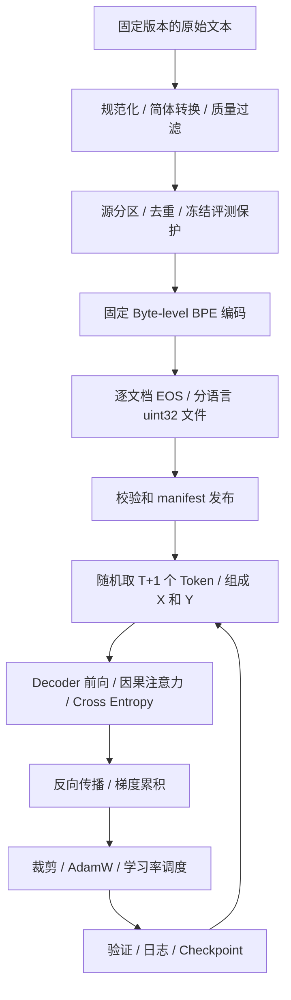

# 从原始文本到模型权重：本项目预训练流程与源码详解

整理完成日期：2026-10-26；主要源码与配置读取于 2026-10-25，交付时再次核对快照。本文解释 `E:\codex\model_training` 当前已经实现的单卡 Decoder-only 预训练流程，以 300M 优化模板为主，同时对照 100M。本文从本地源码、配置和已保存的验收记录整理；没有重新连接远程、启动 GPU 或修改训练实现。正在运行的实际参数应以该次 `runs/configs/` 中带时间戳的冻结配置为准。

本文中的“完整”指本项目预训练链路：数据获取、清洗隔离、分词、流式语料、启动检查、取 Batch、前向计算、Loss、反向与更新、调度、监控、验证、保存恢复、推理，以及这些实现的边界。SFT、LoRA、DPO 属于另外的后训练链路，文末说明区别，不把它们混写为本次预训练的步骤。

## 阅读目录

1. [系统全貌、术语和配置版本](#1-系统全貌术语和配置版本)
2. [源码模块与调用关系](#2-源码模块与调用关系)
3. [原始数据与语料的来源身份](#3-原始数据与语料的来源身份)
4. [下载、JSONL 获取和磁盘边界](#4-下载jsonl-获取和磁盘边界)
5. [文本规范化、简体中文与质量过滤](#5-文本规范化简体中文与质量过滤)
6. [文档分区、冻结评测与去重](#6-文档分区冻结评测与去重)
7. [Byte-level BPE 分词器](#7-byte-level-bpe-分词器)
8. [编码、EOS 和 uint32 Token 流](#8-编码eos-和-uint32-token-流)
9. [新增 2B 数据的事务与最终发布](#9-新增-2b-数据的事务与最终发布)
10. [语料文件和 manifest 的含义](#10-语料文件和-manifest-的含义)
11. [配置校验、环境与启动器](#11-配置校验环境与启动器)
12. [随机数、初始化和严格身份](#12-随机数初始化和严格身份)
13. [一个 Batch 如何产生](#13-一个-batch-如何产生)
14. [模型结构和张量形状总表](#14-模型结构和张量形状总表)
15. [Embedding、RMSNorm 和 RoPE](#15-embeddingrmsnorm-和-rope)
16. [GQA、因果注意力与 SDPA](#16-gqa因果注意力与-sdpa)
17. [SwiGLU、残差和输出投影](#17-swiglu残差和输出投影)
18. [Next Token Prediction 与交叉熵](#18-next-token-prediction-与交叉熵)
19. [反向传播与梯度累积](#19-反向传播与梯度累积)
20. [混合精度、重算和显存](#20-混合精度重算和显存)
21. [梯度裁剪、AdamW 与溢出处理](#21-梯度裁剪adamw-与溢出处理)
22. [Warmup、Cosine 与步数计数](#22-warmupcosine-与步数计数)
23. [验证集、Perplexity 和 best 选择](#23-验证集perplexity-和-best-选择)
24. [日志、W&B、TensorBoard 与时间口径](#24-日志wbtensorboard-与时间口径)
25. [Checkpoint、停止、恢复与异常](#25-checkpoint停止恢复与异常)
26. [预算、测速与多实验隔离](#26-预算测速与多实验隔离)
27. [推理和重复生成的诊断](#27-推理和重复生成的诊断)
28. [SFT 与这套预训练的关系](#28-sft-与这套预训练的关系)
29. [按执行顺序重读整个训练循环](#29-按执行顺序重读整个训练循环)
30. [配置字段字典、测试与局限](#30-配置字段字典测试与局限)
31. [源码定位与快照指纹](#31-源码定位与快照指纹)

## 1. 系统全貌、术语和配置版本

### 1.1 模型究竟在学习什么

预训练让随机初始化的参数拟合文本中下一个 Token 的条件分布：

\[
P_\theta(x_t\mid x_{<t}).
\]

一个 Token 是分词器定义的编号单位，可以是一部分字节、一个字、一段词或带空格的片段，不等同于一个汉字或一个单词。模型通过大量这种预测，学习语言统计结构；知识正确性、连贯生成和任务能力需要另外评测，不能由参数量或训练 Loss 单独保证。

整个流程分成两个时间上独立的阶段：



数据制备阶段在 CPU 完成文本处理。正式 GPU 训练直接读取 Token ID；它不会在每个训练 Batch 中联网取网页、重新清洗或重新拟合分词器。

### 1.2 必须分开的几个计数

| 名称 | 本项目的精确定义 |
| --- | --- |
| 语料容量 | `.bin` 中实际保存的 Token 数，包括文档 EOS |
| 原始数据字节数 | Parquet/JSONL 的文件大小，不能直接换算为 Token 数 |
| micro batch | 一次前向和反向处理的 `B` 个长度为 `T` 的窗口 |
| 梯度累积次数 `A` | 一次参数更新前，串行执行多少个 micro batch |
| optimizer step | 真正执行成功的一次参数更新；训练 `step` 按这个数增加 |
| 处理 Token 数 | 成功更新次数乘 `B×T×A`，不是去重后的覆盖量 |
| epoch | 传统遍历一次数据集的概念；当前随机有放回采样没有严格完整遍历 epoch |
| checkpoint | 模型及优化器、调度器、随机数等完整恢复状态 |

### 1.3 当前配置与历史配置对照

以下是本地模板的值，不代表本文在远程重新确认了某个进程正在使用它。

| 项目 | 100M / 1B | 300M 当前优化模板 | 300M 历史候选 |
| --- | ---: | ---: | ---: |
| 参数数 | 100,092,672 | 303,350,784 | 303,350,784 |
| `dim / n_layers` | 768 / 12 | 1024 / 24 | 1024 / 24 |
| `n_heads / n_kv_heads` | 12 / 4 | 16 / 4 | 16 / 4 |
| `ffn_dim` | 2048 | 2816 | 2816 |
| `vocab_size / seq_len` | 32,000 / 1024 | 32,000 / 1024 | 32,000 / 1024 |
| micro batch `B` | 8 | 8 | 4 |
| 累积次数 `A` | 2 | 4 | 4 |
| Token / update | 16,384 | 32,768 | 16,384 |
| `max_steps` | 61,036 | 91,553 | 183,106 |
| 实际计划处理量 | 1,000,013,824 | 3,000,008,704 | 3,000,008,704 |
| `warmup_steps` | 1000 | 1500 | 3000 |
| 验证 / 保存间隔 | 1000 | 500 | 1000 |
| 每语言验证 micro batch 数 | 2 | 2 | 4 |
| 每语言单次验证 Token | 16,384 | 16,384 | 16,384 |
| Activation Checkpointing | 关闭 | 关闭 | 开启 |

三个配置都使用 BF16、dropout 0.1、峰值学习率 `3e-4`、最低比例 0.1、weight decay 0.1、梯度裁剪 1.0。300M 优化模板把每次更新 Token 翻倍，同时按 Token 口径减半总步数、warmup 和验证间隔；这会改变优化轨迹，不能宣称与原配置逐位等价。

模板定位：[100M](E:/codex/model_training/configs/pretrain/100m_1b.json)、[300M 当前模板](E:/codex/model_training/configs/pretrain/300m_3b.json)、[300M 优化模板](E:/codex/model_training/configs/pretrain/300m_3b_optimized.json)、[旧候选](E:/codex/model_training/configs/pretrain/300m_3b.candidate.json)。旧候选保留单价为空的启动门禁，不作为当前正式命令。

## 2. 源码模块与调用关系

| 职责 | 实际文件与关键入口 |
| --- | --- |
| 配置解析、路径解析、字段校验 | [config.py](E:/codex/model_training/src/llm_lab/config.py)：`load_config`、`ModelConfig`、`TrainConfig`、`ExperimentConfig` |
| 基础 CLI | [cli.py](E:/codex/model_training/src/llm_lab/cli.py)：`main` |
| 300M 冻结配置、GPU 互斥和启动 | [train_300m.py](E:/codex/model_training/scripts/train_300m.py) |
| Wikipedia 获取 | [acquire_stream.py](E:/codex/model_training/src/llm_lab/data/acquire_stream.py) |
| 初始小语料与分词器拟合 | [prepare.py](E:/codex/model_training/src/llm_lab/data/prepare.py) |
| 大规模 Wiki 清洗、磁盘索引与编码 | [streaming_prepare.py](E:/codex/model_training/src/llm_lab/data/streaming_prepare.py) |
| 网页增量下载、编码、恢复 | [corpus_download.py](E:/codex/model_training/scripts/corpus_download.py)、[expand_corpus.py](E:/codex/model_training/scripts/expand_corpus.py) |
| 合并发布与独立检查 | [publish_expanded_corpus.py](E:/codex/model_training/scripts/publish_expanded_corpus.py) |
| 规范化与中文转换 | [common.py](E:/codex/model_training/src/llm_lab/data/common.py)、[text_normalization.py](E:/codex/model_training/src/llm_lab/data/text_normalization.py) |
| Byte BPE | [bpe.py](E:/codex/model_training/src/llm_lab/tokenization/bpe.py) |
| 训练实际取 Batch | [engine/corpus.py](E:/codex/model_training/src/llm_lab/engine/corpus.py)：`BinaryCorpus` |
| 模型 | [decoder.py](E:/codex/model_training/src/llm_lab/models/decoder.py)：`Decoder`、`Block`、`Attention`、`RMSNorm`、`apply_rope` |
| 训练、验证、优化更新 | [pretrain.py](E:/codex/model_training/src/llm_lab/engine/pretrain.py)：`run_pretrain`、`evaluate_model`、`optimizer_update` |
| 随机数、运行环境 | [repro.py](E:/codex/model_training/src/llm_lab/common/repro.py) |
| Checkpoint 原子保存 | [checkpoint.py](E:/codex/model_training/src/llm_lab/engine/checkpoint.py) |
| W&B 与 RNG 保护 | [tracking.py](E:/codex/model_training/src/llm_lab/common/tracking.py) |
| 共享估费账本 | [budget.py](E:/codex/model_training/src/llm_lab/common/budget.py)：`BudgetGuard` |
| 受限性能试验 | [benchmark_300m.py](E:/codex/model_training/scripts/benchmark_300m.py) |
| 独立采样推理 | [generate_text.py](E:/codex/model_training/scripts/generate_text.py) |

代码中还有 `data/corpus.py::TokenCorpus`，它用于数据检查等场景。正式 `run_pretrain` 导入的是 `engine/corpus.py::BinaryCorpus`。理解实际 Batch 路径时应以这个 import 为准。

## 3. 原始数据与语料的来源身份

### 3.1 本次的三份来源

| 来源 | 固定版本 | 作用 |
| --- | --- | --- |
| `wikimedia/wikipedia`，20231101 的 en/zh | `b04c8d1ceb2f5cd4588862100d08de323dccfbaa` | 形成原有约 1.1B 训练池 |
| `HuggingFaceFW/fineweb-2`，`cmn_Hani` | `af9c13333eb981300149d5ca60a8e9d659b276b9` | 新增简体中文约 1B Token，原文仍需转换 |
| `HuggingFaceFW/fineweb-edu`，`sample-10BT` | `87f09149ef4734204d70ed1d046ddc9ca3f2b8f9` | 新增英文约 1B Token |

固定 revision 防止仓库后来更新而产生不可比数据；每个分片还绑定相对路径、文件字节数和 SHA256。网页源保留原 URL、数据行位置和正文 hash。仓库名称不同不意味着内容独立，网页可能包含 Wikipedia 正文或镜像，因此还必须做去重和评测隔离。

这是按有限分片、有限容量做的教学研究语料，不是随机抽样后证明具有全网代表性的语料。ODC-By、CommonCrawl 和原网页权利的具体来源说明见 [数据扩容记录](E:/codex/model_training/docs/data-3b.md)，保留这些来源信息不等于替全部网页重新授权。

### 3.2 最终容量的真实值

| 语言 | 原训练池 | 新增 | 合并 train |
| --- | ---: | ---: | ---: |
| en | 549,999,999 | 1,000,000,429 | 1,550,000,428 |
| zh | 549,999,984 | 1,000,002,609 | 1,550,002,593 |
| 合计 | 1,099,999,983 | 2,000,003,038 | **3,100,003,021** |

目标以整篇文档结束，新数据最多越过每语言目标一篇，所以上表不是严格整数 1B。数据制备的扫描文档数、通过清洗的候选数和最终编码文档数是三种计数，不能互相替代。

最终 manifest SHA256：

```text
f1dbbba35db3f414a36359f96c3a8a6a3b4bba1fb94b09284a5a0fef75c6c7b1
```

该容量来自已保存的验收报告；当前训练是否完成、文件是否随后移动，应另查实际运行状态，本文不把历史验收当作实时远程状态。

## 4. 下载、JSONL 获取和磁盘边界

### 4.1 两种下载入口

Wiki 专用获取器只接受固定 `wikimedia/wikipedia` 仓库、20231101 snapshot 和固定 revision，配置必须各包含一份 en/zh。不能直接把 FineWeb 配置塞进这个入口。网页增量使用独立 `corpus_download.py::fetch_shard`。

下载前检查：完整 revision、64 位 SHA256、正数文件大小、合法仓库内相对路径、输出与缓存目录互不包含、缓存路径留在项目内、目标不是符号链接。正式下载保持 TLS 证书验证，不使用 `verify=False`，也不把签名 URL 或代理凭据写入日志。

网络过程是官方 HF HEAD 经平台已有代理解析文件地址，再直连已签名 HTTPS 文件地址。若响应包含 `X-Linked-Etag`、`X-Linked-Size`，必须匹配固定身份。签名地址只用于本次传输，不作为永久来源路径。

### 4.2 下载中断和校验

文件先写入专用 `.part`。恢复时先读取已有 partial 长度，并重新计算已有内容的 SHA 状态，再发送 `Range: bytes=offset-`。服务器必须返回与原文件大小和 offset 一致的 Content-Range，才能追加；不会把 HTTP 200 的整文件响应错误地拼到已有 partial 后面。

流式下载期间检查剩余空间和收到的字节数；结束后必须同时满足固定长度和 SHA256，之后才 rename 为已验证分片。网络异常保留 partial，可重试；错误输出避免泄漏带签名的 URL。Wiki 默认重试次数由获取配置控制，网页下载器默认最多 5 次，重试等待有上限。

### 4.3 Wiki Parquet 转 JSONL 的事务

Arrow 分小批读取必要列，不调用会额外构建整库缓存的全量 Dataset 加载。每条 Wiki 文档生成：

```text
source_id = wikipedia:20231101:<language>:<id>
language / text / url / title / source_revision
```

获取器维护文档数、JSONL 字节数、正文 UTF-8 字节数和每语言上限，单条 JSONL 有大小限制。完整行不会为了硬凑字节上限而被截断。`.acquisition.lock` 的独占创建阻止两个 writer。

一个分片的提交顺序为：写 raw `.jsonl.part` → flush/fsync → 清单登记 `pending` → rename → 清单登记完成。若进程停在中间，恢复会核对 pending 的长度和 hash，再把它完成为已提交分片。已登记的完成文件会重新核验，发现未登记的完成文件则拒绝覆盖。

Wiki 转换中未提交的本分片可在恢复时重做；已提交 raw 不覆盖。原语料获取、Wiki 清洗制备、网页增量编码分别具有不同恢复协议，不能一概称为“所有阶段都可任意续跑”。

### 4.4 空间为什么不只等于 Token 文件大小

每个 Token 在磁盘为 4 bytes，新增 2B 的 Token 本体约 8 GB。但峰值还包括已下载 Parquet、原始 JSONL、cleaned 候选、SQLite/WAL、审计、分片 `.part`、追加提交时的临时副本和模型 checkpoint。

Wiki 制备配置的空间水位是 8 GiB；本次网页增量配置为 12 GiB。后者在分片提交并确认后只删除专属缓存中的普通文件，不跟随外部路径。新网页不额外保存一份完整 raw/cleaned JSONL，保留 Token、hash、源行/URL 和下载身份。原始网页恢复需要按记录重新下载；从 Token 解码只能得到规范化后的训练文本。

## 5. 文本规范化、简体中文与质量过滤

### 5.1 `normalize_text` 的逐步处理

实际顺序：Unicode NFC → CRLF/CR 统一为 LF → 去除除制表/换行外的 Unicode C 类字符 → 每行水平空白合并为空格并去首尾空白 → 连续至少 3 个换行合并为两个 → 全文去首尾空白。

Unicode C 类包括控制、格式、代理、私用和未指派字符。实现不是随手列几个黑名单字符，而是按当前 Python Unicode 数据库构建允许范围的正则，首次调用才构建并缓存。Unicode 版本因此也会影响数据身份。

NFC 将某些规范等价的组合形式统一；它不会做繁简转换。控制字符删除也不等于词义清洗。整个规范化不是对所有可能输入都可随意交换顺序的操作，不能为优化性能任意省略转换后的再次规范化。

### 5.2 简体转换为何做固定点迭代

中文路径是：

```text
原文 → normalize_text → 官方 OpenCC t2s → normalize_text
     → 检查再次转换结果是否稳定 → hash / 去重 / 编码
```

英文走同一接口但不做 t2s。正式规则强制官方 C++ `OpenCC==1.4.2`，核对 distribution 与 native 版本、扩展文件类型和哈希、配置及其引用词典；拒绝悄悄退回同名纯 Python 实现。

单次词组转换不总能稳定。例如已有制备诊断发现某些字形先改变，第二次才能匹配另一条词典。因此转换最多迭代 8 次：相邻结果相等才返回；用 SHA256 检测循环；到上限仍变化就失败。循环和未收敛结果不会被用来生成最终语料 hash。

normalizer 的 provenance 记录包/native 版本、配置、词典及 native 扩展 SHA、算法名、最大迭代次数等。扩展语料必须与父语料的完整 provenance 相同，仅写一句“都用了 t2s”不足以保证可比。

### 5.3 质量过滤的实际阈值

| 规则 | 当前值 | 代码意义 |
| --- | ---: | --- |
| 规范化后字符数 | 80～100,000 | 太短或超长丢弃；不切成伪完整文档 |
| 最常见单字符占比 | 不大于 0.5 | `max(Counter(text).values()) / len(text)` |
| 非空行去重比例 | 不小于 0.5 | `不同非空行数 / 非空行总数` |

这是轻量质量规则。它不能证明事实准确、语法正确、所有网页模板已清除或内容没有偏差。网页增量还会在转换前拒绝原文本超过配置最大长度两倍的条目，以避免超大单条输入。

## 6. 文档分区、冻结评测与去重

### 6.1 先按文档来源分区，再切 Token

稳定分区由 `SHA256(f"{seed}:{source_id}")` 的前 16 个十六进制位变成 `[0,1)` 的数，再按配置比例分为 train/validation/test。默认比例 0.98/0.01/0.01。不能先把一篇文章切成窗口，再把相邻窗口随机放到不同 split。

同一个 `source_id` 的不同语言或变体应共享分区。流式 Wiki 制备若发现显式 split 与稳定分区不一致，通常报错；旧冻结来源按已确认的分区处理。

### 6.2 Wiki 的磁盘去重与保护图

SQLite 使用 `sources`、`contents`、`source_hashes`、`records`、`frozen_sources`、`frozen_hashes` 等表，避免把数百万文档索引全放进 Python 容器。正文先统一简体，再计算 SHA256，繁简等价文本因此能进入同一去重口径。

冻结验证/测试的 source ID、原始规范正文 hash、转换后的 hash 都受保护。对同一来源/正文发现不同 split 时，配置可选择直接错误或保守排除冲突训练内容。保护优先级是 test、validation、train。

实现还传播“来源—正文 hash”二部关系：一个受保护来源连接某个重复正文，正文又连接别名来源，就把整组的保护级别反复传播到不再变化，解决 train 先出现、holdout 后出现的顺序依赖。最终重写审计记录的有效保护分区。`cleaned.jsonl` 只是候选，编码前仍要查询最终索引的 `_active`，不能直接把所有 cleaned 行都训练。

### 6.3 冻结评测并不等于永远保留旧中文字节

早期中文评测曾混合繁简。统一规则时，先验证旧正文/Token 身份，再重建简体中文 holdout；英文按字节保留。之后从已验收的 `wikipedia_1b` 扩到 3.1B 时，验证/测试与分词器哈希继续保持不变。不能把不同繁简版本的 Loss 当成完全同一评测直接比较。

旧 tokenizer 只在当时 train 上拟合，但“历史 train-only”不证明新的转换后 holdout 与它的拟合样本在语义、近重复意义上绝对独立。已保存验收覆盖了明确声明的原始/转换 hash；不把这个范围扩大成“完全无污染”。

### 6.4 新网页使用的隔离范围

网页增量先把父审计中的全部 source/hash 加入磁盘 `seen`，包含预算没有最终编码的候选，做保守排除。URL 只接受无用户名/密码的 HTTP(S)，host 小写并移除尾点，合并 HTTP/HTTPS 和 fragment 变体，保留 query，避免把真正不同页面错误合并。

Wikipedia、Wikimedia、Wikibooks、Wikisource、Wiktionary、Wikiquote、Wikiversity、Wikivoyage、Wikidata 等域名及其子域名直接排除。合法新来源用规范 URL 的 hash 构造 `web:<hash>`。原 ID、仓库限定 ID、规范 source ID、URL、转换前/后正文 hash 都参与重复检查。

父实际 holdout 正文还会：casefold → 去空白 → 对每个字符偏移构造 100 字符的 64-bit 多项式滚动指纹。新文档包含命中片段时整篇排除。该指纹长度是规范化后的字符数，不是 100 Token；它可以抓插入空白、大小写和前后包裹的镜像。

必须保留的边界：滚动指纹不是语义模型，短于窗口、改写、翻译和所有近重复没有全覆盖保证；64 位指纹理论上可能碰撞。增量 writer 对每篇实际接受文本做检查，但没有实现 Wiki 保护图那种对全部网页历史版本的全局回撤。不能声称两个去重实现具有完全相同的整组传递保证。

## 7. Byte-level BPE 分词器

### 7.1 拟合与复用的区别

初始小语料由 `prepare_pretrain` 在清洗后的 train 文档上拟合 tokenizer，验证/测试不参与拟合；审计也记录看过但因 Token 总预算未输出的训练文档。大规模 Wiki 和 3.1B 扩展复用这份固定的 32,000 词表，不是每次扩数据都重训 BPE。

新训练 tokenizer 的受限流式分支还支持从最终 active train 中按每语言字节预算采样，保存采样文件 hash；实际本轮走的是复用路径。所有路径都要求真实词表大小等于配置，容量不足时失败，不自动缩小词表从而改变模型参数量。

固定 tokenizer SHA256：

```text
6040c90c045836982a47bc0544942f122d0446bf9ed4d2ac1929befd0d4b86b3
```

### 7.2 实际组件

```python
Tokenizer(models.BPE(unk_token="<|unk|>"))
normalizers.NFC()
pre_tokenizers.ByteLevel(add_prefix_space=False)
decoders.ByteLevel()
```

Trainer 使用完整 256 字节字母表、给定词表大小、`min_frequency`，并注册 `<|pad|>`、`<|unk|>`、`<|eos|>`。当前验收语料的 PAD ID 为 0、EOS ID 为 2；读取时以 manifest 和 tokenizer 实际一致性为准，不在训练器里任意改编号。

ByteLevel 将字节映射成可见字符，BPE 再学习高频片段合并。`你好` 的字节层可以显示为 `ä½łå¥½`，空格可显示为 `Ġ`，换行可显示为 `Ċ`；这些不是原文含有相应外文词。单个 Token 可能只是汉字的一部分字节，整串 decode 才能正确还原。模型接收 ID，不直接处理这些用于查看词表的字符串。

`encode(..., add_special_tokens=False)` 后由制备器显式追加一个 EOS；没有额外自动插入聊天模板、BOS 或每段用户/助手角色。PAD 被定义在词表里，但当前固定窗口 Batch 不需要 padding。

## 8. 编码、EOS 和 uint32 Token 流

### 8.1 连续文件的形成

每篇通过最终过滤的文档执行：

```python
ids = tokenizer.encode(text, add_special_tokens=False).ids + [eos_id]
binary = np.asarray(ids, dtype="<u4").tobytes()
```

`<u4` 是 little-endian、4 字节、无符号整数。每个语言和 split 各有一个文件，按被接受文档的顺序连续追加。训练 `.bin` 没有 JSON header，数量、dtype、字节序和 hash 在 manifest。

```text
文档 A 的 IDs, EOS, 文档 B 的 IDs, EOS, 文档 C 的 IDs, EOS, ...
```

EOS 是一个可学习的结束符，不会主动重置注意力，也不会导致 `.bin` 被分成独立 Tensor。后续随机窗口可能跨越它。

### 8.2 两种 Token 上限策略

原 Wiki 制备在每语言最多约 550M 的硬上限内，整篇放不下就跳过，继续看后面的短文档，不截掉半篇，因此最终略低于上限。新增网页则把每语言 1B 当最低目标，接受最后一篇完整文档后允许略超出，然后停止该语言。不能把两种策略混为同一种取整。

Wiki 批编码默认最多 64 篇、正文合计最多 4 MiB，单篇超出字节阈值时独占一批；批大小上限 1024。批量只改变分词调度，不改变文档顺序、EOS、过滤和整篇容量规则。网页 Parquet 的 Arrow batch 默认 64、最多 128，使用 `use_threads=False`；tokenizer 的 Rayon 线程由 CPU 制备环境单独控制。

### 8.3 故障完成凭证

Wiki 清洗制备器明确不支持恢复未完成输出目录。输出非空时拒绝覆盖，失败留下 `preparation_state.json`，需要审计后选新目录重做。所有容量、输入大小/mtime、hash 和隔离检查通过，才最后原子写出 `manifest.json`。

仅看到 `.bin`、SQLite、某个 progress 的 `complete` 字样，不足以证明正式语料已经发布。

## 9. 新增 2B 数据的事务与最终发布

### 9.1 以旧训练池为前缀

`prepend_parent_train=true` 时先核验旧两条训练流的大小和 SHA，再用独立临时文件复制为新输出的前缀。这里不能直接硬链接旧 train 后再追加，否则会把旧语料也改掉。复制 fsync 后 rename，断电前的未完成复制可在恢复时重做。

进度分别记录 `base_tokens`、新增 `committed_tokens`、`total_committed_tokens`。一篇新文档的 `new_token_offset` 从新增流的零开始，`token_offset` 则加上该语言旧前缀长度，指向合并文件中的真实位置。

### 9.2 SQLite 是已提交位置的权威

`dedup.sqlite` 开启 WAL、`synchronous=FULL`，缓存预算约 32 MiB，包含：

| 表 | 作用 |
| --- | --- |
| `meta` | 配置/流水线身份、父审计是否已种入 |
| `seen` | 已保护或已接受的 source / URL / 正文 hash |
| `commits` | 每分片累计 Token 数、审计字节数、文档数、来源和统计 |

独占 `writer.lock` 位于任何恢复截断和索引写入之前。每片事务顺序：

1. 取得并核验一个完整 Parquet。
2. 开启 SQLite 写事务，过滤、分词，把本片 Token 和审计写到专用 `.part`。
3. fsync 两个 part。
4. 将 part 追加到最终 train 与 `incremental_audit.jsonl`，再次 fsync。
5. 把累计 offsets/counts 和来源插入 `commits`，提交 SQLite。
6. 写 checkpoint/progress，删除 part 和本片可重新下载缓存。

若第 4 步后、提交前崩溃，文件尾部可能已经有新数据，但 SQLite 没有它。恢复时按最后提交的数量截断 train 到 `(base+new)×4`，审计截到提交字节数；未提交的 seen 回滚，未提交 part 删除重做。若 SQLite 已提交、进度 JSON 还没更新，则以 SQLite 为准，不重复追加。

pipeline 身份覆盖配置、父 manifest、worker/downloader/common/normalizer 源码 SHA、Python/Unicode 版本及完整 OpenCC provenance。恢复配置或处理语义改变时拒绝混写。已完成的 `expansion_manifest.json` 会在恢复截断之前核验并直接返回，避免损坏已发布结果。

这套原子性主要针对检查过的进程中断边界；没有宣称已完成所有硬件掉电、文件系统损坏和跨设备崩溃实验。

### 9.3 增量完成与完整发布是两件事

worker 只负责 `expansion_manifest.json` 和 `incremental_audit.jsonl`，不会冒充完整的训练 manifest。它先检查两条总训练流的大小和词表 ID 范围，再保存真实计数、hash、来源和限界。

publisher 另持 `publish.lock`，确认 writer 已结束，再检查父 manifest / tokenizer / audit / holdout 正文、两条训练流完整 SHA、旧前缀段 SHA、增量段 SHA。按每篇已编码审计检查全局 offsets 连续、Token 数量、EOS 和词表范围，使用 SQLite 的唯一约束检查新增 source/hash 唯一；每语言每 5000 篇抽样解码正文核对 hash。

合并审计是父审计加新增 `encoded` 行，过滤掉新增处理中无正文 hash 的拒绝行；完整新增审计仍另外保留。验证/测试、tokenizer 和实际 holdout 正文校验后使用硬链接，避免复制不变文件。最终 `acceptance.json` 和 `manifest.json` 使用临时文件、fsync、`os.replace` 原子发布。

已保存验收中新增英文 908,984 篇、中文 922,467 篇，共 1,831,451 篇；解码正文抽样英文 182、中文 185 篇。真实训练加载器额外验证中英 train/validation 的 `[4,1024]` Batch。抽样解码不是逐篇重做全部原文获取，不能把验收范围写成全量独立重编码。

## 10. 语料文件和 manifest 的含义

远程正式语料根目录是：

```text
/root/autodl-tmp/model_training/artifacts/pretrain/bilingual_3b/
```

| 文件 | 含义 |
| --- | --- |
| `train.en.bin`、`train.zh.bin` | 旧前缀加新增的实际训练 Token |
| `validation.en.bin`、`validation.zh.bin` | 冻结验证流，周期性模型选择使用 |
| `test.en.bin`、`test.zh.bin` | 冻结独立测试流，最终评测才使用 |
| `tokenizer.json` | 词表、合并规则、normalizer/pre-tokenizer/decoder |
| `manifest.json` | 正式数据入口、文件身份、实际计数、来源与验收 |
| `document_audit.jsonl` | 合并后的来源/正文 hash 与保护分区账本 |
| `incremental_audit.jsonl` | 新增逐行处理结果，含来源、URL、row、offset 和状态 |
| `documents.jsonl` | 实际冻结 holdout 正文，不能当完整训练原文 |
| `dedup.sqlite` | 增量处理的去重索引和提交位置 |
| `expansion_manifest.json` | 增量阶段完成凭证，不含完整评测流入口 |
| `checkpoint.json`、`progress.json` | 数据处理进度，不是模型权重 |
| `acceptance.json` | publisher 的验收摘要 |

manifest 的 `token_count` 包含 train、validation 和 test；训练池容量应单独求 `splits.train.en/zh.token_count`。本次总字段是 3,100,471,343，而 train 合计是 3,100,003,021，二者相差 468,322 个冻结评测 Token。

`sampling.language_probabilities` 记载设计配比，实际精确中英平衡由训练循环每个 micro batch 交替及偶数累积约束实现，不是在运行时随机掷硬币决定语言。

原 Wiki raw 保存在 `/root/autodl-tmp/model_training/artifacts/raw/wikipedia_1b/raw/`。原 Wiki 的 cleaned/index/audit 被父 manifest 引用，不能作为无用缓存删除。新网页的 Parquet 已按制备策略清缓存；保留来源后可以重新下载，完整原始网页并不常驻当前目录。

## 11. 配置校验、环境与启动器

### 11.1 配置不是 Python 脚本

`load_config` 读取 JSON，使用严格 dataclass 拒绝未知字段。`model` 和 `train` 拼错字段会报错，不静默退到默认值。预算也有字段白名单。未填写字段才按 dataclass 默认值补齐，因此不能把默认 micro batch 2、累积 8 与正式 JSON 的 8×4 混为一谈。

有 `project_root` 时相对配置文件所在目录解析；没有时向上寻找 `pyproject.toml`，然后解析 `data_manifest`、`output_dir` 和账本为绝对路径。当前工作目录不是配置路径的唯一依据。

主要校验包括：模型维度为正、`dim % n_heads == 0`、`n_heads % n_kv_heads == 0`、head_dim 为偶数、dropout 范围正确、seq_len 不超过 max_seq_len、学习率/裁剪等有限正数、warmup 不超过总步数。中英逐 micro batch 交替，因此梯度累积次数必须为偶数。

CPU 正确性配置只允许 FP32。GPU 正式训练还检查 CUDA 可用、BF16 支持和正数实际单价；付费运行必须共用项目根目录的 `runs/budget_ledger.json`。`--validate-only` 主要验证配置结构，不等于读完全部语料、实际分配目标模型或证明 GPU 性能。

### 11.2 `.env`、系统 CUDA 与 PyTorch

远程项目根为 `/root/autodl-tmp/model_training`。`scripts/env_remote.sh` 将 HF、pip、Torch、W&B、临时文件目录指到数据盘项目中，设置 `PYTHONPATH`，保留本机 E 盘/远程数据盘的存储约束。

带时间戳 `.env` 另外导出 `RUN_STAMP`、`RUN_CONFIG`、`RUN_DIR`、`RUN_LOG`，切到项目根并加载公共环境，设置 `OMP_NUM_THREADS=8`、`MKL_NUM_THREADS=8`、`CUDA_VISIBLE_DEVICES=0`。这些线程设置不代表数据加载器自动启动 8 个 DataLoader worker。

运行环境中需要区分：驱动及 `nvidia-smi` 显示的支持上限、系统 CUDA Toolkit、PyTorch wheel 自带的 CUDA runtime。项目使用 torch 的 CUDA 功能，不要求把系统 Toolkit 替换成与 wheel 名称完全相同的版本。具体可用性由运行时探针和实际短测确认。

### 11.3 为什么先冻结配置

`train_300m.py prepare` 只创建新实验配置，不训练。它核对固定 3.1B manifest、32K tokenizer、验收状态和每语言至少 1.5B 容量，核对 303,350,784 参数结构及 3B 处理计划。当前启动器正式计划支持每步 16,384 或 32,768 Token；不是任意 Batch 都可改而无需重建计划。

prepare 用北京时间生成一次时间戳，给 output、W&B 名称和配置共用它，以 `open('x')` 独占创建 JSON / identity / env，拒绝覆盖旧文件；实际模型输出目录留到训练器初始化时创建。`.identity.json` 绑定冻结 JSON SHA、数据/tokenizer SHA、核心源码 SHA、输出和计划计数。

实际执行时 `frozen_config` 再核验这些身份。标记 `cleared` 的旧 run 禁止复用，避免删除权重后又把新随机训练混进旧预算/W&B。正式配置被修改后不能沿用原身份文件继续。

### 11.4 防止并行抢占

Linux 启动器在整个 `check/probe/start/resume` 调用期间持 `flock(LOCK_EX|LOCK_NB)` 项目锁 `runs/.gpu_training.lock`，同时检查已有训练命令和 GPU 计算 PID。锁文件不在退出时删除，避免另一个进程仍持旧 inode 时出现第二把独立的“锁”。

新实验初始可用空间门槛约 20 GiB。resume 根据已经存在的 last/best 的独立 inode 文件大小减去已占用部分，门槛不低于 8 GiB，避免硬链接文件被重复计入。它还检查本实验原目录 `last.pt`、共享预算和输出目录状态。

旧基础 CLI 不使用这把外部锁，无法靠新锁阻止用户绕过启动器手工并行调用旧 CLI。整个项目仍按单卡、单训练 writer 设计；预算账本没有多进程事务合并。

### 11.5 各种启动动作的语义

| 动作 | 行为 |
| --- | --- |
| `prepare` | 生成一个独立实验及冻结配置；不训练 |
| `check` | 校验冻结身份、语料、进程、GPU、空间、账本；不执行模型训练 |
| `probe --steps 32` | 从随机参数开始，用完整学习率终点训练到 step 32 后保存退出 |
| `start` | 新建训练，输出必须为空 |
| `resume` | 只恢复此实验原目录的 `last.pt` |
| `status` | 展示 launcher、summary、W&B 状态，并在 Linux 检查原 PID 的 argv |

`probe` 的步数是绝对停止步数参数，不是把正式 `max_steps` 改成 32。基础 CLI 的 `--max-steps 32` 会改变总调度与身份，不能替代它。

## 12. 随机数、初始化和严格身份

### 12.1 可复现需要保存不止一个 seed

`seed_everything` 设置 Python `random`、NumPy 全局 RNG、Torch CPU、所有 CUDA RNG，并控制 `torch.use_deterministic_algorithms`，关闭 cuDNN benchmark。GPU 入口设置 `CUBLAS_WORKSPACE_CONFIG=:4096:8`，关闭 CUDA matmul TF32。

取训练窗口另用独立的 `np.random.default_rng(seed)`。这是一个有不断推进状态的 Generator，不能只在恢复时重新设 seed，否则会从头重复取窗口。模型 Dropout 消费 Torch RNG；SDK 消费全局随机数也可能改变训练，所以 W&B 另有保存/恢复 RNG 的保护。

相同 seed 不是跨不同 Torch、CUDA、硬件、内核的逐位一致性保证；本项目用环境和源码身份拒绝不受控的恢复变化，而不是宣称任意机器结果都相同。

### 12.2 模型权重的实际初始化顺序

1. 创建 Embedding、各层 Attention/FFN、最终 RMSNorm 和输出 Linear。
2. 所有 Embedding/Linear 使用 `Normal(0, 0.02)` 初始化，RMSNorm 的可学习 weight 是全 1。
3. 若 `tie_embeddings=true`，令输出头 weight 指向输入 Embedding 的同一个 Parameter，不是复制两个数值相同但独立的矩阵。
4. 每层注意力输出矩阵和 FFN down 矩阵再按 `std=0.02/sqrt(2*n_layers)` 初始化，降低深层残差分支初始幅度。

共享前的输出矩阵初始化也消费过 RNG，因此重写初始化顺序会改变数值轨迹。新 300M 重新随机初始化，不能把 100M 的不同维度 checkpoint 直接按普通 resume 扩容。

### 12.3 训练环境快照和严格身份字段

环境快照记录 Python、平台、Torch/NumPy/tokenizers/Transformers/datasets/PEFT/TRL/accelerate/TensorBoard/W&B 版本、Torch CUDA、GPU、Git revision/dirty。恢复比较使用其中 Python、packages、torch_cuda、gpu；platform/Git 信息也记录，但不是此字典中的全部字段都参与相等判断。

核心 `source_fingerprint()` 对 `src/llm_lab/` 下全部 `.py` 的相对文件名和内容 SHA 做 canonical hash。新增一个尚未调用的 `.py` 也会改变它；不是仅比较 `pretrain.py`。文档和独立 `scripts/` 不在这个核心指纹范围内，但各外部工具仍应有自己的版本记录。

运行身份包含：

```text
规范配置 hash
manifest SHA256 / tokenizer SHA256
train 数据 fingerprint / validation 数据 fingerprint
核心 source fingerprint
Python / packages / torch_cuda / gpu
```

计算配置 hash 时移除 `budget`、`output_dir`、`project_root`，把 data_manifest 路径替换为其文件 hash；其余 model/train 字段仍在，包括 W&B 名称、Batch、种子和调度终点。移除路径不是任意搬家都保证可恢复，相关文件仍需可访问，外部启动器还核验固定输出和冻结 JSON 的完整 hash。

资源预算不在核心模型身份中，使资源上限可单独管理；300M 启动器更严格地冻结整个 JSON，因此修改正式 JSON 仍会被启动器拒绝。两层校验不能混为一谈。

## 13. 一个 Batch 如何产生

### 13.1 启动时实际加载哪个类

```python
training = BinaryCorpus(data_manifest, "train", seq_len)
validation = BinaryCorpus(data_manifest, "validation", seq_len)
```

构造函数对 en/zh 分别检查：文件路径留在 manifest 目录下、dtype 为 uint32、数量大于 `T`、文件长度等于 `token_count×4`、实际 SHA 匹配。随后核验 tokenizer 路径和 SHA，创建 `np.memmap(file, dtype='<u4', mode='r')`。

memmap 让随机访问由操作系统页缓存管理，不等于必须把整库创建成一个 RAM Tensor。启动时为了校验 SHA 仍会流式读完对应文件，因此首次无 GPU 指标的等待可能是读 12.4GB 训练数据，而不是训练已经卡死。

### 13.2 从起点到 Tensor 的全部形状

设语言流长度为 `N`、micro batch 为 `B`、上下文为 `T`：

```python
offsets = rng.integers(0, N - T, size=B)  # 上界不包含 N-T
chunks = np.stack([
    stream[int(start):int(start) + T + 1]
    for start in offsets
]).astype(np.int64)
x = torch.from_numpy(chunks[:, :-1].copy())
y = torch.from_numpy(chunks[:, 1:].copy())
```

起点范围是 `0 ... N-T-1`，刚好保证还能取出 `T+1` 个 Token。`chunks` 是 `[B,T+1]`，`x/y` 均为 `[B,T]`。磁盘 uint32 转成 `np.int64` 后得到 Torch `long`；明确 copy 避免把只读 memmap 直接作为可写 Tensor 的共享底层存储。

300M 当前 micro batch `B=8,T=1024`：先取 `[8,1025]`，再得到两个 `[8,1024]`；不是一次读 31 亿 Token 到 GPU。

小例子，设 T=4，一行窗口是 `[11,25,8,30,7]`：

```text
x = [11,25, 8,30]
y = [25, 8,30, 7]
```

位置 0 用可见前文 `[11]` 预测 25；位置 1 用 `[11,25]` 预测 8，依此类推。`y` 已在数据层对齐为下一个 Token，模型中不再额外 shift。

### 13.3 随机采样的真实含义

这是独立、有放回的随机起点抽样，同 Batch 内也允许相同或重叠窗口。靠近流两端的 Token 可被包含的窗口数量少于中间 Token，因此它也不是逐位置严格等频的完整遍历。

窗口可以从句子中间开始、跨文章 EOS、在结尾停在半句。制备保留整篇 EOS 与训练按固定窗采样是两个不同层面：原文件未截掉文章，并不意味着每个 Batch 都包含完整文章。

当前路径没有 PyTorch `DataLoader`、多 worker、异步预取、`pin_memory` 或显式 `non_blocking=True` 拷贝；它在 Python 循环中取 memmap 切片、复制到 CPU Tensor，再 `.to(device)`。这些是可以研究的性能方向，不是已经实现的功能。

## 14. 模型结构和张量形状总表

记 `B=8,T=1024,C=1024,Hq=16,Hkv=4,D=C/Hq=64,F=2816,V=32000,L=24`。这些数对应当前 300M。100M 改成 `C=768,Hq=12,F=2048,L=12`，head_dim 仍为 64。

| 阶段 | 一般形状 | 300M micro batch 形状 |
| --- | --- | --- |
| 输入 / 标签 IDs | `[B,T]` | `[8,1024]` |
| Embedding / 残差流 | `[B,T,C]` | `[8,1024,1024]` |
| Q Linear 输出 | `[B,T,Hq*D]` | `[8,1024,1024]` |
| K / V Linear 输出 | `[B,T,Hkv*D]` | `[8,1024,256]` |
| 分头后的 Q | `[B,Hq,T,D]` | `[8,16,1024,64]` |
| 分头后的 K / V | `[B,Hkv,T,D]` | `[8,4,1024,64]` |
| 显式重复后的 K / V | `[B,Hq,T,D]` | `[8,16,1024,64]` |
| 注意力分数，概念形状 | `[B,Hq,T,T]` | `[8,16,1024,1024]` |
| 拼回各头 | `[B,T,C]` | `[8,1024,1024]` |
| FFN gate/up 中间值 | `[B,T,F]` | `[8,1024,2816]` |
| 输出 logits | `[B,T,V]` | `[8,1024,32000]` |
| Cross Entropy 输入 | `[B*T,V]` | `[8192,32000]` |
| Cross Entropy 标签 | `[B*T]` | `[8192]` |
| Loss | 标量 | 8192 个目标位置的平均 Loss |

注意力矩阵只是数学形状；融合实现可以避免完整物化它，不能直接把该表每项大小相加当显存峰值。

参数量可从无 bias 的实际模块推导。令 `Ckv=Hkv*D`，tied embedding 时：

\[
N=VC+L\left(2C^2+2CC_{kv}+3CF+2C\right)+C.
\]

解释：Q 与 out 各 `C²`，K/V 共 `2*C*Ckv`，gate/up/down 共 `3*C*F`，每层两个 RMSNorm 共 `2C`，最终 norm 为 `C`，Embedding `V*C` 与输出矩阵只计一次。代入得到 100,092,672 和 303,350,784。`.parameters()` 会去除同一 Parameter 的重复引用，因此优化器也不会把 tied weight 更新两次。

## 15. Embedding、RMSNorm 和 RoPE

### 15.1 Embedding 查表

Embedding 是 `[V,C]` 的可训练矩阵。输入 ID `i` 选择第 `i` 行，得到一个 C 维向量。它不是在线把字符串重新“理解”为向量，也没有调用外部预训练 embedding 服务。

输入 `[B,T]` 变成 `[B,T,C]`。本模型没有单独的可学习绝对位置 Embedding；位置信息通过每层 Attention 的 RoPE 进入。

### 15.2 RMSNorm 对哪一维归一化

每个 Batch、每个时间位置独立地对最后的 C 维计算：

\[
\mathrm{RMSNorm}(x)_i = w_i\frac{x_i}{\sqrt{\frac1C\sum_{j=1}^{C}x_j^2+10^{-6}}}.
\]

不减均值；`w` 是长度 C 的可学习向量，没有 bias。平方、均值和倒平方根使用 FP32，结果转回输入 dtype 后乘 weight；最终 dtype 还受 Torch 类型提升影响。它不把不同句子、不同时间位置混在一起求均值。

这是 Pre-Norm 结构：先 norm 再进 Attention/FFN，再加回未经该 norm 覆盖的残差流，末尾再做一次最终 norm。

### 15.3 RoPE 的计算细节

每层都从自己的 Q/K 投影得到新 Q/K，再施加旋转；不旋转 V。设 head_dim 为偶数 D、位置 p、维对编号 i：

\[
\omega_i=\theta^{-2i/D},\qquad \phi_{p,i}=p\omega_i,\quad \theta=10000.
\]

对该位置的相邻偶/奇两维：

\[
\begin{bmatrix}a'\\b'\end{bmatrix}=
\begin{bmatrix}\cos\phi&-\sin\phi\\\sin\phi&\cos\phi\end{bmatrix}
\begin{bmatrix}a\\b\end{bmatrix}.
\]

频率、角度与旋转计算临时使用 FP32，再转回原 Q/K dtype。Q 和 K 的头数可以不同，因为旋转只要求最后的 D 相同。位置张量广播形状为 `[1,1,T,D/2]`。

当前每次训练窗口的位置从 0 到 T-1；不是整条数十亿 Token 流的全局绝对位置。频率和三角函数每次 Attention 调用重新计算，没有专门缓存。训练也没有 KV cache；解码缓存属于另一个推理优化问题。

## 16. GQA、因果注意力与 SDPA

### 16.1 投影与分头

本实现 Q/K/V/out 都是 `bias=False` 的 Linear。Q 头数多于 K/V 头数：300M 中每 4 个 Q 头共享一组 K/V 参数；100M 中每 3 个 Q 头共享一组 K/V 参数。

投影后先 `view` 成 `[B,T,H,D]`，再 `transpose(1,2)` 成 `[B,H,T,D]`。Q/K 经过 RoPE 后，把 K/V 沿头维 `repeat_interleave(Hq/Hkv)`，再进入 SDPA。这里通过显式扩展兼容 CPU 路径，并没有传 `enable_gqa=True` 使用原生不扩展路径。

GQA 减少 K/V 投影参数；但当前实现把 K/V 激活显式扩展，因此不能把理想 GQA 的全部运行显存优势照搬到本代码。也没有 MoE 的专家选择、路由或负载均衡损失。

### 16.2 自注意力公式与因果遮罩

\[
S=QK^\top/\sqrt D+M,\quad A=\mathrm{softmax}(S),\quad O=AV,
\]

其中 `M[i,j]=0` 当 `j<=i`，否则为负无穷，阻止当前位置看到未来输入 Token。代码调用：

```python
F.scaled_dot_product_attention(q, k, v,
    is_causal=True,
    dropout_p=self.dropout if self.training else 0.0)
```

softmax 沿最后的 key 位置维度归一化。注意力概率训练时 dropout=0.1，eval 时明确传 0；SDPA 不会仅因模块 `.eval()` 自动替调用者改这个参数。

当前只有标准因果遮罩，没有按文档段落构造 block-diagonal mask。因此同一窗口中后一篇文章的 Token 可以注意到前一篇文章，EOS 只是告诉模型有边界。也没有 padding attention mask，因为窗口长度固定。

### 16.3 SDPA 与 FlashAttention 的关系

SDPA 是 PyTorch 接口，具体执行哪个融合/数学后端取决于设备、dtype、形状、dropout、确定性及运行时能力。源码没有强制某个 FlashAttention 包或固定后端，不能只因用了 SDPA 就宣布每次都在运行 FlashAttention。

各头结果转置回 `[B,T,Hq,D]`，用 `.contiguous().view(B,T,C)` 保证内存布局可用，再过输出矩阵。数学上的注意力工作量包含随 T² 增长的部分，增大上下文的成本不只是 Token 数线性增长。

PyTorch 接口与后端说明：[SDPA 2.9 文档](https://docs.pytorch.org/docs/2.9/generated/torch.nn.functional.scaled_dot_product_attention.html)。本段算子形状和实际调用以项目源码为依据。

## 17. SwiGLU、残差和输出投影

一个 Block 精确执行：

```python
x = x + dropout(attn(attn_norm(x)))
n = ffn_norm(x)
x = x + dropout(down(silu(gate(n)) * up(n)))
```

FFN 公式为：

\[
\mathrm{FFN}(x)=W_{down}\left(\mathrm{SiLU}(W_{gate}x)\odot W_{up}x\right),
\quad \mathrm{SiLU}(z)=z\sigma(z).
\]

gate/up 将 C 映射到 F，逐元素门控后 down 映射回 C。不是普通 ReLU 的两层 FFN；三个矩阵无 bias。每层有两个残差分支 dropout，另有 Attention 内的概率 dropout；Embedding 和最终 logits 没有额外专门的 dropout 模块。

经过 L 层后执行最终 RMSNorm 与 `lm_head`，得到 `[B,T,V]` 原始 logits。此处没有先 softmax；Cross Entropy 内部完成 log-softmax。输出头与输入 Embedding 共享同一权重；损失会通过输出投影和输入查表两条路径对同一 Parameter 累积梯度。

## 18. Next Token Prediction 与交叉熵

### 18.1 不是每个窗口只预测最后一个词

在因果遮罩下，T 个位置可以并行计算各自的下一 Token 预测。训练提供真实历史 Token，这通常称 teacher forcing；推理才把生成出来的 Token 继续作为后文输入。

对于一个 micro batch：

\[
\mathcal L=-\frac1{BT}\sum_{b=1}^{B}\sum_{t=0}^{T-1}
\log P_\theta(y_{b,t}\mid x_{b,0:t}).
\]

源码：

```python
loss = F.cross_entropy(
    logits.float().reshape(-1, vocab_size),
    labels.reshape(-1),
    ignore_index=-100,
)
```

`logits.float()` 为数值稳定性把 Cross Entropy 输入转为 FP32。标签是类别索引，不是 `[B,T,V]` one-hot；默认 reduction 为所有未忽略位置的平均值。对每个位置，logit 的梯度是预测概率减真实类别的 one-hot，经链式法则传播到前面所有相关模块。

### 18.2 哪些位置算 Loss

当前 `BinaryCorpus` 直接构造完整 `y`，没有把任何正常位置设置成 -100，也没有 SFT completion-only mask。EOS 对应的预测也参与 Loss。词表定义了 PAD ID 不等于 `cross_entropy` 自动忽略 PAD；实际忽略编号明确是 -100。固定窗流程不为对齐主动添加 PAD。

### 18.3 数值与能力的关系

随机均匀预测 32K 词表的平均负对数概率约为 `ln(32000)=10.37`。这是参考量，不是每个实际随机模型的初始 Loss 必须恰好相等。Loss 下降说明在指定采样分布上的下一 Token 预测改善，不保证每条知识正确或长文本不重复。

## 19. 反向传播与梯度累积

### 19.1 一次参数更新的执行顺序

每次 update 先 `model.train()`、`optimizer.zero_grad(set_to_none=True)`，再串行执行 A 个 micro batch。语言固定为 `("en","zh")[micro % 2]`，每个 update 都从 en 开始，所以 A 必须为偶数。

300M 当前 `8×4`：

| micro 编号 | 语言 | 输入形状 | 有效目标 Token |
| --- | --- | --- | ---: |
| 0 | en | `[8,1024]` | 8192 |
| 1 | zh | `[8,1024]` | 8192 |
| 2 | en | `[8,1024]` | 8192 |
| 3 | zh | `[8,1024]` | 8192 |
| 更新一次 | en/zh 各半 | 串行完成后更新 | 32,768 |

100M 是两个 micro batch，各 `[8,1024]`，每次更新 16,384 Token。不要把累积后的有效 Batch 写成 GPU 实际同时前向了 `[32,1024]`。

### 19.2 为什么 backward 前除以 A

每个 micro batch 自己已经对 B*T 目标求平均，累积时执行：

```python
scaler.scale(loss / A).backward()
```

从而得到 `g=(1/A)Σ grad(L_micro)`，在每批有效 Token 数相同时对齐整个有效 Batch 的平均损失。否则累积次数越多梯度就会额外放大。`loss_sum` 累加未除 A 的标量用于日志，最终日志记录 `loss_sum/A`。

PyTorch 默认把梯度累加到 `.grad`，因此 micro 之间不 zero_grad。`set_to_none=True` 让清空时梯度恢复为 None，避免始终做整块清零；梯度是在实际 backward 时重新分配/产生的。

### 19.3 等效 Batch 不保证逐位等价

从 4×8 改到 8×4，即使有效 Token 总数相同，也改变浮点加法顺序、采样分组以及 Dropout RNG 消费方式；从 8×4 改到 8×8 还改变更新频率和优化轨迹。数据、模型、Batch 和调度冻结后再训练，不能在原断点中途任意调整。

## 20. 混合精度、重算和显存

### 20.1 BF16、FP16、FP32 分别在哪里

模型用默认 FP32 Parameter 创建，只在 forward 与验证中使用 `torch.autocast(device, dtype=...)`；没有调用 `model.bfloat16()`。dtype=fp32 时用空 context，BF16/FP16 才使用 autocast。

| 对象 | 本实现的典型精度 |
| --- | --- |
| 磁盘 Token | uint32，小端 |
| 输入与标签 | int64 / Torch long |
| Parameter / 梯度 | FP32 |
| AdamW 一阶、二阶矩 | FP32，随 FP32 Parameter 建立 |
| 支持 autocast 的 Linear/矩阵运算 | BF16 或 FP16 |
| RMS 规约、RoPE 中间三角运算 | 显式 FP32，按代码转回 |
| 残差流 / 其他中间值 | 由输入和类型提升决定，不能一概称 BF16 |
| Cross Entropy 输入与 Loss | logits 显式 FP32，Loss 通常 FP32 |

BF16 与 FP32 具有相同数量的指数位，动态范围大于 FP16，但尾数精度更低。本实现只有 `device=cuda and dtype=fp16` 时启用 GradScaler；BF16 和 FP32 路径的 scaler 是禁用的统一接口。

### 20.2 Activation Checkpointing 重算了什么

当配置开启且 `model.training` 为真，每层调用：

```python
checkpoint(block, x, use_reentrant=False, preserve_rng_state=True)
```

减少 forward 保存的中间激活，在 backward 按需重算相应 block，以额外算力换显存。`preserve_rng_state=True` 保持重算 Dropout 使用正确随机状态；它不是保存磁盘 `.pt` checkpoint。验证/推理时 `.eval()`，不会进入这个重算分支。

当前 300M 优化配置关闭重算，是已保存短测中吞吐更好的配置；它不是所有模型、GPU 和上下文下永远最佳的选择。[PyTorch 重算机制](https://docs.pytorch.org/docs/2.9/checkpoint.html)

### 20.3 参数显存只是峰值的一部分

FP32 参数、梯度和 AdamW 两份矩状态的主要张量约 `16N bytes`：100M 约 1.49 GiB，300M 约 4.52 GiB。优化器矩在首次更新时建立，峰值还包括激活、算子临时值、显式 KV 扩展、logits/FP32 CE 转换和 CUDA allocator 预留。

300M 的 `[8,1024,32000]` logits 有 262,144,000 个元素；BF16 版本约 0.488 GiB，显式 FP32 版本约 0.977 GiB，两者还可能暂时共存。不能用“303M×2 bytes”估算整轮训练显存。

梯度累积串行释放各 micro batch 的计算图，保留累积梯度，不会同时保留 A 份完整激活。增大 A 通常不像增大 B 那样直接提高激活峰值，但总训练步数、日志和 optimizer 频率也相应改变。

## 21. 梯度裁剪、AdamW 与溢出处理

### 21.1 更新前先反缩放，再裁剪

`optimizer_update` 按以下顺序工作：

```text
scaler.unscale_(optimizer)
→ clip_grad_norm_(parameters, max_norm)
→ 有限性检查
→ scaler.step(optimizer)
→ scaler.update()
```

若启用了 FP16 loss scaling，backward 算的是放大后的梯度，裁剪前必须 unscale；否则阈值 1.0 的意义会被缩放因子改变。禁用 scaler 时这些接口仍可统一调用。

默认总 L2 范数 `||g||₂` 超过阈值 c=1.0 时，按统一比例缩小各梯度；返回的 norm 是裁剪前值。它不是逐元素 clip，也不会把所有梯度都强行变成长度 1。浮点实现为避免除零含数值稳定项，理论上可写成 `g←g*min(1,c/||g||₂)`。

### 21.2 参数分组与 AdamW 的数学意义

`optimizer` 的两个分组：二维及以上 Parameter 的 weight_decay=0.1，一维 Parameter 的 weight_decay=0。当前一维主要是 RMSNorm 的 scale，不做衰减；本模型没有 Linear bias。

更新使用 `AdamW(lr=..., betas=(0.9,0.95))`。核心公式为：

\[
m_t=\beta_1m_{t-1}+(1-\beta_1)g_t,\qquad
v_t=\beta_2v_{t-1}+(1-\beta_2)g_t^2,
\]

\[
\hat m_t=m_t/(1-\beta_1^t),\quad
\hat v_t=v_t/(1-\beta_2^t),\quad
\theta_t=(1-\eta_t\lambda)\theta_{t-1}-\eta_t\hat m_t/(\sqrt{\hat v_t}+\epsilon).
\]

一阶矩平滑梯度方向，二阶矩调整不同参数的更新尺度；weight decay 独立于梯度矩估计。项目没有覆盖 epsilon，PyTorch 2.9 默认 `1e-8`；也没有显式要求 fused/foreach、AMSGrad 或 optimizer state offload，具体内部执行路径由运行时默认选择。不是使用 SGD 或手写 Adam。[AdamW 参数说明](https://docs.pytorch.org/docs/2.9/generated/torch.optim.AdamW.html)

### 21.3 非有限数如何处理

- 每个 micro batch 的 Loss 若 NaN/Inf，直接抛 `FloatingPointError`，不继续污染权重。
- 裁剪返回非有限梯度范数且 scaler 禁用时，立即报错。BF16 不会靠 loss scaling 自动回退。
- FP16 scaler 启用时，`unscale_` 已登记 found_inf；`scaler.step` 不实际更新参数，`scaler.update` 调整 scale，随后清梯度，本次返回 `updated=False`。
- 失败更新不推进 scheduler、`step` 或 `tokens_seen`；采样器和 Dropout RNG 已经消费，下一轮会取后续随机窗口，并不会重放完全相同的失败 Batch。
- 连续跳过超过 32 次（第 33 次）报错；成功一次会把连续计数清零。

这也是为什么“处理 Token”在日志中特指成功计入更新的预算，不包括失败 FP16 尝试实际消耗过的计算。

## 22. Warmup、Cosine 与步数计数

### 22.1 学习率函数的真实公式

`LambdaLR` 的乘子是：设 scheduler 索引 s、warmup W、总更新数 S、最低比例 r：

\[
f(s)=\begin{cases}
(s+1)/W,& W>0\ \text{且}\ s<W,\\
r+(1-r)\{1+\cos(\pi p)\}/2,&\text{其他},
\end{cases}
\quad p=\mathrm{clip}\left(\frac{s-W}{\max(1,S-W)},0,1\right).
\]

实际 `lr = peak_lr*f(s)`。当前 300M 的 peak=3e-4、W=1500、S=91553、r=0.1，最低目标为 3e-5。W=0 时直接从 cosine 起点开始，不能除以零。

### 22.2 off-by-one 与调用顺序

PyTorch LambdaLR 初始化时已应用 s=0，第一步使用 `peak/W`，本配置为 `2e-7`。每次 update 开始先记录当前 optimizer LR；完成 optimizer 更新后调用 `scheduler.step()`，再将训练 `step` 加一。

因此日志里的 LR 是刚执行的那次更新使用的值，不是 scheduler 为下一次准备的值。索引为 W-1 和 W 时乘子都为 1，warmup 接 cosine 处可相邻两步同为峰值。最后一次实际更新通常使用 f(S-1)，更新后的 scheduler 状态是 f(S)=r；不能把保存的最后 LR 与该步更新前 LR 混用。

### 22.3 Token 预算如何变成整数步数

\[
K=BTA,\quad S=\lceil D_{target}/K\rceil,\quad D_{actual}=SK.
\]

当前 300M：`K=32768`，`S=ceil(3,000,000,000/32768)=91553`，实际 `3,000,008,704`。旧候选 K=16384，对应 183106 步；8×8 的 K=65536 对应 45777 步，会多取整一个完整大 update，不能仍用 91553 步而无意训练约 6B。

只有真正更新成功后才 `step += 1`、`tokens_seen += K`。训练中途从正常 checkpoint 恢复，从已保存的计数继续；不能重新生成一个更长 `max_steps` 后称为原学习率计划的严格恢复。

## 23. 验证集、Perplexity 和 best 选择

### 23.1 验证在何时运行

成功更新并增加 step 后，满足 `step % eval_interval == 0` 或到最终步，调用 `evaluate_model`。当前 300M 每 500 步验证，100M 每 1000 步验证；32 步 probe 尚未到首次完整验证周期。

验证函数使用 `@torch.no_grad()`，先保存原来的 training 状态，调用 `model.eval()`，结束时通过 `finally` 恢复。eval 关闭模型 Dropout、把 Attention dropout 明确设为 0，且不进入激活重算分支。验证同样使用配置的 autocast，不需要反向梯度图。

### 23.2 验证样本怎样保持可比

每次验证都重新建立独立 Generator：en 用 `seed+10000`，zh 用 `seed+10001`。这保证同配置下每次抽到同样的验证窗口，也不会推进训练窗口采样器的状态。

每语言读取 `eval_batches` 个 `[B,T]` micro batch，平均各 micro batch 的 Cross Entropy。固定长度、相同 B/T 且无 -100 mask 时，micro Loss 的算术平均等于对这些目标位置的平均值。当前 300M 每语言 `2×8×1024=16384` 个预测目标；不是遍历整份 validation 文件。不同窗口可以重叠，固定窗口结果是可比较的小规模估计，不是精确全量语料期望。

修改 B 或 eval_batches 后，即使目标 Token 总量相同，窗口起点的随机数消费及分组也可能不同，不应承诺抽到逐个相同的目标。

### 23.3 记录哪些验证指标

\[
L_{en}=\mathrm{mean}(L_{en,1},\ldots),\quad
L_{zh}=\mathrm{mean}(L_{zh,1},\ldots),\quad
L_{macro}=(L_{en}+L_{zh})/2.
\]

两种语言等权，与本实验目标一致。不能把它解释成按两个完整验证流长度加权的全库平均。

Perplexity 定义为 `exp(mean negative log probability)`。实现使用：

```python
perplexity = math.exp(min(average_loss, 80.0))
perplexity_capped = average_loss > 80.0
```

Loss 非有限时报错。大于 80 时指数被截顶以避免溢出，必须同时看 capped 字段，不能把截顶后的数字当精确 PPL。不同 tokenizer 的 Token 粒度不同，PPL 不适合跨 tokenizer 直接排名；中英文数值也受各自分词效率影响。

### 23.4 best 是怎样选出来的

首次验证，或当前 `macro_loss` 严格小于历史 best 时，更新 `best_val_loss`，保存当前完整 `last.pt`，复制为 `best.pt.tmp` 后原子替换 best。相等时不替换 best；训练集 Loss 不参与 best 的选择。

独立 test 不进入这个循环。基础 CLI 的 test 评估需要显式 `--allow-test`，避免用 test 来挑模型。最终评估输出绑定原 checkpoint 与 manifest/tokenizer 身份。

## 24. 日志、W&B、TensorBoard 与时间口径

### 24.1 训练日志不是每十步 Loss 的平均

`log_interval=10` 时，只有每 10 步或最终步写一条记录。`train_loss` 是**当前这一次参数更新内 A 个 micro batch 的平均**，不是最近 10 步的平均，也不是整个训练的累计平均。

| 字段 | 实际口径 |
| --- | --- |
| `step` | 累计成功 optimizer update 次数 |
| `tokens_seen` | 累计成功更新计入的预测目标 Token |
| `train_loss` | 当前 update 的 micro Loss 平均 |
| `learning_rate` | 本次更新开始时的 LR |
| `grad_norm_before_clip` | unscale 后、裁剪前的总梯度范数 |
| `tokens_per_second_including_eval` | 本次启动以来新计入 Token / 本次记录时已用时间 |
| `elapsed_seconds_this_session` | 当前调用内的计时，不含早期已结束会话 |
| `peak_cuda_bytes` | 本次调用 reset 后 Torch 峰值 allocated，不是 GPU 总占用 |
| `budget` | 本次记录时更新的共享估费账本摘要 |
| `validation` | 仅本步同时触发验证时附带 en/zh/macro 指标 |

每条 JSON 写到 `metrics.jsonl` 后 flush，并向 stdout 打印；后台 stdout/stderr 由 nohup 追加到带时间戳控制台日志。控制台重复显示同一 JSON 属于不同介质记录，不是两次更新。

### 24.2 tokens/s 为什么会波动

记录前显式 `torch.cuda.synchronize()`，避免只测 CPU 提交内核的时间。循环中把 Loss 和梯度范数转成 Python 标量、做有限性判断也可能触发 GPU 同步；当前实现不是完全异步的吞吐优化器。

计时开始在模型/优化器和 TensorBoard 初始化之后、W&B 初始化之前。因此累计 tokens/s 包含 W&B 启动、已发生的验证、保存和之前的日志开销，但不包含前面的全量语料 hash 与模型创建。它使用 `tokens_seen-initial_tokens`，避免恢复后把历史 Token 除以新会话的时间。

每步记录的时间在本条日志的写入/W&B/打印之前取得；本步末尾普通 save 也在记录后。它们会计入下一条记录，但最后一条指标不包含之后的最后保存和 W&B finish。summary 的预算终值有不同计时边界。

推算剩余时间优先用同一启动会话内、跨至少一次完整验证与保存的增量：

\[
v=\frac{D_b-D_a}{t_b-t_a},\qquad
t_{remain}=\frac{D_{plan}-D_b}{v}.
\]

不能把两个不同会话各自从 0 重新计时的 elapsed 直接相减。首次初始化、保存和共享资源波动都会使短窗口不稳定。GPU-Util、allocated、reserved、`nvidia-smi` 进程显存和实际 FLOPs 利用率是不同指标；不能以“显存没有占满”直接推断训练失败。

### 24.3 W&B 的实际接入

tracking 配置校验不需要导入 SDK，实际启动才严格要求 `wandb==0.30.0`。项目显式创建 W&B 目录、NETRC/credentials 路径，关闭代码/Git 与模型权重自动记录。项目自己的 `numeric_metrics` 递归把嵌套有限数值展开为 `budget/...`、`validation/...`，过滤文本、路径、bool 和非有限值；SDK 仍可能记录其正常的运行配置与系统元数据。

`wandb_run.json` 保存 project/entity/mode/job_type 身份、experiment_id、run ID、resolved entity、URL 和离线分段。

- 新运行生成新 ID，不按相同模型结构自动复用旧运行。
- 在线 resume 使用原 ID 且 `resume='must'`；必须保留匹配的 `wandb_run.json`。
- 离线 resume 创建新的段 ID，共用 experiment/group，避免覆盖离线历史。
- 定义 `optimizer_step` 为指标横轴；W&B 内部提交次序不等同于模型 optimizer step。

SDK init/log/finish 包在 `preserved_rng` 中，保护 Python、NumPy、Torch CPU/CUDA 的随机状态。线上监控不应偷偷改变 Dropout 与数据采样的轨迹。

启动阶段的 SDK 缺失、版本不符、身份不符或 init 失败会抛错；**不是所有 W&B 故障都会被忽略**。进入训练后的 log 异常则写 `wandb_error.json`、停止继续远程 log，保留本地训练；finish 异常发警告。W&B 显示失败与模型权重是否已正常保存需要分别检查。

### 24.4 TensorBoard 与恢复日志

TensorBoard 记录 train_loss、learning_rate、grad_norm_before_clip、tokens/s，以及验证时中英 Loss。构造 SummaryWriter 时 resume 使用 `purge_step=step+1`，用于隐藏恢复位置之后的旧事件。

`metrics.jsonl` 是 append，代码没有在恢复时把未持久化 checkpoint 之后的旧指标行截掉。若异常发生在上次 save 后，恢复较早 checkpoint，JSONL 可能出现重复或回退的 step；分析时应识别会话和恢复段，不假设整个文件严格单调。

### 24.5 初期为什么看不到输出

初始化要核对 Token 文件与 tokenizer 的 hash、创建模型/optimizer、恢复状态、建立监控，进入循环后还要到 log_interval 才打印训练指标。`python -u` 解决 Python 标准输出缓冲，不能绕过初始化工作或把日志间隔改成每步。

观察顺序是进程、控制台日志更新、GPU 活跃度和 metrics，不要单看 `summary.json`：它只在本次调用正常退出后写入，运行中可能仍显示上一次 32 步 probe 的 `simulated_interruption`。

## 25. Checkpoint、停止、恢复与异常

### 25.1 完整 checkpoint 保存什么

| 键 | 为什么必须保留 |
| --- | --- |
| `schema_version` | 拒绝不支持的文件协议版本 |
| `config` | 重建相同模型、优化设置与数据路径 |
| `identity` | 检查数据、代码、配置与环境相符 |
| `run_id` | 关联原实验和累计预算 |
| `environment` | 原始环境证据 |
| `model` | 全部模型 Parameter |
| `optimizer` | AdamW 矩、内部 step 和分组 |
| `scheduler` | 原学习率计划的位置与状态 |
| `scaler` | FP16 缩放状态；禁用时也是明确的状态 |
| `rng` | Python、全局 NumPy、Torch CPU/CUDA RNG |
| `sampler_rng` | 独立 `default_rng` 采样器状态 |
| `step / tokens_seen` | 累计成功更新与 Token 计数 |
| `best_val_loss` | 保留历史模型选择门槛 |

保存只有 model weight 的文件可以用于另建阶段初始化，但不足以原样续训。本项目 last/best 都是完整训练状态，体积比只有权重大。

### 25.2 保存的时点与原子性

只在整个梯度累积 update 完成的边界保存，不保存“已经累积了一半”的梯度。

触发点：验证改善时先保存并更新 best；每 save_interval 或最终 step 保存 last；正常离开循环后再保存一次 last。某些步会因此多次保存，这是真实控制流，不是把一次 save 自动合并了。

`save_checkpoint` 写同目录 `last.pt.tmp`，`torch.save` 后 flush/fsync，最后 `os.replace`。进程在写新临时文件时出错，旧正式 last 不会被半文件直接覆盖。

best 使用 `copyfile(last, best.pt.tmp)` 再 replace。该 best 复制路径没有显式单独 fsync，父目录也没有统一 fsync；因此这里的原子替换保障不能扩展成“所有文件系统上任意断电都绝对持久”。

### 25.3 正常停止怎样到达保存点

主线程注册 SIGINT 和 SIGTERM handler。收到信号时仅设置 `stop_requested=True` 并打印说明，不在任意 CUDA 计算中间直接打断。本次更新、可能正在执行的验证/保存结束后，下次循环顶部检查标志并 break，离开循环后保存 last。

正常状态值：

| `summary.status` | 含义 |
| --- | --- |
| `completed` | 达到正式 max_steps |
| `signal_stop` | 在更新边界响应 SIGINT/SIGTERM |
| `budget_or_time_limit` | 预算或本次启动时间阈值触发 |
| `simulated_interruption` | `stop_after_steps` 短测边界退出 |

最后 finish tracker、更新账本、关闭 TensorBoard、恢复旧 signal handler，再写 summary。看到当前 summary 的 `signal_stop`，才能按正常流程认定已完成这次停止保存。

`tail -f` 的 Ctrl+C 只退出 tail。前台训练的 Ctrl+C 作用于训练进程；nohup 后台训练需要对正确 PID 发信号。SIGKILL、直接关机、OOM 和非有限异常没有相同的保存承诺。

### 25.4 异常不是正常停止

训练 try/finally 会尝试 finish 监控与更新账本，但 final persist 位于正常离开 while 后，**不在无条件 finally 中**。Loss 非有限、CUDA OOM、磁盘满或其他异常可能直接绕过这次最后保存；只能恢复上一次完整写出的 checkpoint。

不要为了“异常也存一份”就在半完成梯度或已污染权重时覆盖 last。当前实现不自动减 Batch、不重新创建 optimizer、不自动换精度来掩盖这些失败。

### 25.5 resume 的实际顺序

恢复时仍先按当前配置建立数据、身份、模型、optimizer、scheduler/scaler 和采样器；读取旧 checkpoint 后先比较 identity，再依次载入 model、optimizer、scheduler、scaler、累计计数、采样器状态和全局 RNG。

初始化阶段会消费 RNG，但最终旧 RNG 覆盖它，使后续继续在恢复位置消费随机数。重新创建 scheduler 不代表从头 warmup：load_state_dict 恢复原位置。

Loader 使用 `torch.load(..., map_location='cpu', weights_only=False)`，允许 Python RNG 等对象，随后按训练器建立的设备恢复；它不把整个 checkpoint 一口气直接加载到 CUDA。仅加载自己生成且可信的 `.pt`，不要将任意外来 pickle 当作纯数值文件。

核心身份不允许改变模型维度、Batch、精度、数据、种子或总调度。300M 启动器还核验冻结文件和输出目录，因此 100M checkpoint 不能作为 300M 的普通 resume 参数。

### 25.6 文件体积和复现实验的范围

300M 模型及两个 Adam 矩的主要 checkpoint 张量约 `12N=3,640,209,408 bytes`，即约 3.39 GiB，另有元数据。last、best 和原子临时文件可能同时存在，约 10.17 GiB 的主要张量峰值还需外加日志和剩余空间水位。

已完成基线若 best/last 的完整 SHA 相同，可经授权使用硬链接保留两个文件名而减少重复块占用；活动输出不应在训练期间做这种存储整理。清理 20 步 probe 权重后，保留小型报告只能证明历史验证做过，不能再从被删除的权重恢复。

CPU fixture 已覆盖“完整运行”与“含 Dropout/验证的中断恢复”模型和 optimizer 等状态一致的测试。该证据不是任意 GPU/内核和任何故障方式下的逐位复现保证。

## 26. 预算、测速与多实验隔离

### 26.1 共享账本与估费公式

`BudgetGuard` 是单进程估算器。每个 run_id 在根 `runs/budget_ledger.json` 中保存累计秒数与计算估费：

\[
C_{run}=C_{prior}+\Delta t\cdot rate/3600.
\]

恢复沿用 prior cost；单价变化时保留旧累计费用，只对新会话增加新单价的费用，不重算历史。项目费用是账本各 run 的累计和。

在每次 update 开始前更新账本并检查：单 run 费用上限、项目 `limit-reserve`、本次 `time.monotonic()-started` 的会话时间上限。当前默认总额 500 元、余量 100 元，300M run limit 180 元、会话时间 72 小时。费用跨 resume 累计；72 小时不是所有恢复会话的累计总上限。

BudgetGuard 建立在语料哈希、模型创建和恢复之后，其估费计时包括后面的监控与训练阶段，但不完整覆盖实例从开机起的全部计费时间。数据准备、空闲、存储和其它账单须查平台；不能把账本当平台余额。一次更新和之后验证/保存还可使实际时间超过边界，阈值是软停止条件。

该账本没有跨进程写锁，`update()` 是读 JSON、修改、原子写回。两个训练同时运行可能发生覆盖；外部启动器的单训练锁是配套约束。换输出目录不应作为抹掉项目历史费用的手段。

### 26.2 受限测速具体测了什么

`benchmark_300m.py` 默认只生成计划，显式 execute 才串行执行受限 GPU worker。worker 要核对控制器父 PID/环境标记，控制器持项目训练锁；计划绑定源码、脚本、配置、目录，限制单项和总时长、磁盘、允许试验规模，并只清自己计划目录中的测试权重。

`balanced32k` 比较 8×4 关闭重算、16×2 关闭重算、16×2 开启重算，保持每步 32,768 Token，短测最多 12～32 步。指标取 step 6 至结束的增量 Token/时间，尽量避开初始化；没有走到第 500 步的首次验证/保存周期。

`accumulation64k` 固定对比 8×4 的 24 步与 8×8 的 12 步，总处理量同为 786,432 Token。稳定窗口分别 6→24 和 3→12，均为 589,824 Token；日志频率也按 Token 对齐。比较时不能只看“每步耗时”，因为每步处理量不同。

候选需正常、Loss/梯度有效、保存完成，并留下至少 `max(总显存*15%,6GiB)` 的 reserved 显存余量。自动数值排名按符合门槛的最高短测 tokens/s；工程选择还要考虑波动、优化轨迹和重复测试证据。

### 26.3 已保存结果怎样使用

[当前优化记录](E:/codex/model_training/docs/run-300m-optimized.md) 记载：第一轮 8×4 无重算约 31,674 Token/s、allocated 19.65 GiB、reserved 20.72 GiB，优于本次另外两组。后续等 Token 测试中 8×4 约 31,904、8×8 约 32,090 Token/s，差约 0.584%，小于两次 8×4 本身约 0.725% 的点估计波动，因此继续选择 8×4。

这些数字来自保存的远程短测报告，不是本文重新测量，也不是正式全程速度和质量保证。0.725% 不是统计置信区间。由 31,674 粗算 3B 的纯训练约 26.31 小时；完整验证、保存和环境波动需另外计入，不把它写成必定完成时间。

### 26.4 小模型和大模型怎样隔离

模型实例、配置、output、last/best、控制台日志、TensorBoard 与 W&B run 按时间戳独立。分词器和评测流可以只读复用；300M 不写回 100M 权重或旧 manifest。

两者仍共用 GPU、磁盘、包环境、核心源码和项目预算。同卡并行会争抢算力/显存；升级依赖或修改核心源码还可能让旧模型的严格 resume 失败。因此“文件隔离”不等于“资源和环境完全无关联”。

本地保存后的源码同步是单向推送白名单，排除 runs/artifacts/tmp/venv/凭据。远程有项目 Python 正在运行时，接收器保守推迟写入，避免让运行中的训练混用源码。本文只增加文档，不主动连接远程、重启服务或触发训练。

### 26.5 流程命令示例

以下仅演示由用户执行的步骤，已有训练运行时不要再新起一轮。新实验先 prepare，然后使用它打印的原 env 路径；已存在的实验不重复 prepare。

```bash
cd /root/autodl-tmp/model_training
source scripts/env_remote.sh

# 仅在需要一个全新的独立实验时生成配置。
.venv/bin/python scripts/train_300m.py prepare \
  --template configs/pretrain/300m_3b_optimized.json

# 替换为 prepare 打印的实际文件名；以后一直沿用同一份。
source "/root/autodl-tmp/model_training/runs/configs/pretrain_300m_3b_YYYYmmdd_HHMMSS.env"

.venv/bin/python scripts/train_300m.py check --config "$RUN_CONFIG"
.venv/bin/python -u scripts/train_300m.py probe --config "$RUN_CONFIG" --steps 32

# probe 已保存并退出后，续训同一实验。
nohup .venv/bin/python -u scripts/train_300m.py resume \
  --config "$RUN_CONFIG" >> "$RUN_LOG" 2>&1 < /dev/null &
TRAIN_PID=$!
printf '训练 PID: %s\n' "$TRAIN_PID"
tail -f "$RUN_LOG"
```

停止应在另一个已确认 PID 的终端执行 `kill -INT PID`，等 summary 对应本次停止后再操作实例；不要把文档中的示例 PID 或已结束会话的 PID 当成永久标识。停止训练进程不会自动停止租赁实例。

## 27. 推理和重复生成的诊断

### 27.1 两个推理入口不同

基础 `python -m llm_lab.cli generate` 仍是每步 logits argmax 的贪心生成，会初始化 `BinaryCorpus(validation)` 校验配套评测流；它没有 temperature/top-p 参数。独立 `scripts/generate_text.py` 不改核心训练源码，另外实现采样、重复惩罚和可保存的生成报告，不能把两套 CLI 参数混用。

独立脚本载入 checkpoint 配置，核对原 manifest SHA、tokenizer SHA/词表/EOS、路径边界，创建同结构 Decoder、加载 model state、转到指定设备并 `.eval()`。它只需 checkpoint、原 manifest 和 tokenizer，**不会再要求读取 validation bin**；这是与基础 CLI 的具体依赖差异。

独立 loader 在 CPU `fork_rng` 范围内初始化再载入权重，减少对调用者 RNG 的影响；checkpoint 本身仍包含 optimizer 等训练状态并先在 CPU 加载，因此读取开销大于单独模型权重包。模型没有 Hugging Face AutoModel 的自动注册/导出协议，不能把 `.pt` 文件直接当成任意 Transformers 模型仓库。

### 27.2 一次生成如何循环

prompt 用同一 BPE 编码，空输入用 EOS 作为起始上下文。每次截取最近 max_seq_len 个历史 Token，构造 `[1,T_current]`，在 inference_mode 下 forward，只取最后位置 logits。没有 KV cache，每产生一个 Token 都重算整个当前窗口；窗口滑动后位置又从 0 开始。

代码用完整 prompt+生成历史做重复约束，即使 forward 只看最近窗口。到 EOS、最大新 Token 或所有候选被约束排空时停止；返回 stop_reason、生成 ID、完整解码和 completion。最后 EOS 不显示为正文。

### 27.3 采样分数处理的顺序

1. 复制 FP32 logits，拒绝 NaN、正无穷和错误维度。
2. 对历史出现过的 ID 施加 repetition penalty：负 logit 乘 r、非负 logit 除 r，使其分数降低；不是对所有 logits 无条件除 r。
3. 屏蔽 PAD、UNK 和会重复已出现 n-gram 的下一 Token；EOS 保留为可结束候选。
4. greedy 时直接 argmax，仍保留前面的重复/屏蔽处理。若要比较“完全无惩罚贪心”，应把 penalty 设为 1、ngram 设为 0，并注意该独立脚本仍屏蔽 PAD/UNK。
5. 采样时先减最大 logit，再除正温度，避免极低温度的正溢出。
6. top-k 留下最高分候选；top-p 对剩余候选排序，保留累计概率首次越过阈值的那个 Token，并保证最高分不会被误删。
7. 使用 CPU `torch.Generator(seed)` 与 multinomial 抽样。采样器独立，不承诺不同设备的 logits 浮点差异完全消失。

脚本默认 temperature=0.8、top-p=0.9、top-k=50、penalty=1.1、no_repeat_ngram_size=0、seed=42、CPU threads=4。它们是试验起点，不是每个小模型的最优配置。`--output` 只允许项目内新路径并拒绝覆盖。

Byte BPE 可能在前缀/生成边界切分 UTF-8，整段 `full_text` 统一 decode 比只拼两个分别解码的字符串更稳妥。词表中的 `Ġ`、`Ċ` 等是字节显示方式，不能直接据此把正常编码判断为损坏。

### 27.4 重复为什么不能只归因于一个开关

贪心可能持续选择同一高概率句式；弱预训练也可能只学到定义模板而概念关系不可靠。验证是给定真实前文的预测，自由生成则不断依赖自己生成的前文。低验证 Loss 与自然流畅长文不是同一个指标。

诊断应固定 checkpoint、Tokenizer、多个提示和随机种子，对比完整贪心与采样；同时核查真正的训练 step/tokens、验证走势、生成重复率和事实准确性。单条输出不能证明训练成功或失败。增大参数、增加训练 Token、改采样或追加 SFT 都有不同作用，没有一个能自动保证消除全部重复。

## 28. SFT 与这套预训练的关系

预训练与 SFT 都可以使用同一类因果语言模型和 Cross Entropy；区别在初始化、数据组织和哪些目标位置计入 Loss。

| 项目 | 当前预训练 | 典型 SFT |
| --- | --- | --- |
| 权重 | 从随机参数开始 | 加载已有 Base 权重 |
| 输入 | 原始文档 Token 窗口 | 应用聊天模板的指令/回答序列 |
| Label | 全部下一 Token | 通常用户/模板位置为 -100，助手回答与必要结束标记参与 |
| 优化状态 | 本阶段自己的 AdamW/调度 | 通常新建该 SFT 阶段的优化器/调度 |
| 评测 | 语言建模 Loss/PPL 与独立测试 | 指令遵循、任务准确率等也需验证 |

用户问题即使不算 Loss，仍作为预测回答的上下文。SFT 不是给预训练的同一 `.bin` 换一个名字，也不是把换数据/标签后的阶段冒充严格 `--resume`。

当前项目既有后训练实现面向固定 Qwen2.5-0.5B 的 Transformers/PEFT/TRL 路线，位于 `workflows/posttrain*.py`；不能据此宣称自定义 100M/300M `.pt` 已能直接接上同一个 HF SFT 配置。要为自定义 Decoder 做 SFT，须实现相应数据/聊天模板/label mask 与初始化路径，并单独验证。LoRA 是可用于 SFT 的参数更新方法，不是 SFT 的同义词。

## 29. 按执行顺序重读整个训练循环

以下是带说明的等价流程索引，不作为替代真实训练器的第二套实现。

```python
# 初始化阶段：不属于一个 optimizer update。
validate_config_and_device()
reject_nonempty_new_output_or_missing_resume()
set_global_rng_and_deterministic_flags()
train_corpus = verify_and_map_train_streams()
validation_corpus = verify_and_map_validation_streams()
identity = bind_config_data_source_environment()
model = initialize_decoder_on_target_device()
optimizer = create_adamw_decay_and_no_decay_groups(model)
scheduler = create_full_warmup_cosine_plan(optimizer)
scaler = create_scaler(enabled=(cuda and fp16))
sampler = np.random.default_rng(seed)

if resume:
    verify_identity_before_loading_states()
    restore_model_optimizer_scheduler_scaler()
    restore_counters_sampler_and_global_rng()

write_config_environment_run_manifest()
create_shared_budget_guard_and_tensorboard()
install_signal_handlers()
tracker = initialize_wandb_with_rng_preservation()

while step < max_steps:
    # 在完整更新边界检查，停止后走循环外的正常保存。
    if signal_requested or budget_or_time_exhausted or probe_boundary:
        break

    model.train()
    optimizer.zero_grad(set_to_none=True)
    loss_sum = 0.0
    used_lr = optimizer.param_groups[0]["lr"]

    for micro in range(accumulation):
        language = ("en", "zh")[micro % 2]
        x, y = train_corpus.batch(language, micro_batch_size, sampler)
        with autocast:
            # x/y 是已错开一位的 [B,T] long Tensor。
            loss = model(x.to(device), y.to(device)).loss
        reject_nonfinite_loss(loss)
        loss_sum += float(loss.detach())
        scaler.scale(loss / accumulation).backward()

    updated, grad_norm = unscale_clip_then_scaler_step_and_update()
    if not updated:
        handle_overflow_without_advancing_scheduler_or_counters()
        continue

    scheduler.step()
    step += 1
    tokens_seen += micro_batch_size * seq_len * accumulation

    if validation_due_or_final:
        metrics = evaluate_fixed_validation_windows()
        if validation_macro_loss_improved:
            update_best_loss()
            persist_last_and_replace_best()

    if logging_due_or_final:
        synchronize_cuda_and_measure_session_metrics()
        append_local_jsonl_and_log_wandb_tensorboard_stdout()

    if save_due_or_final:
        persist_complete_last_checkpoint()

# 仅正常路径到达这里；异常时不保证这一份新 checkpoint。
persist_complete_last_checkpoint()
finish_tracking_update_budget_close_writer_restore_handlers()
write_summary()
```

伪代码中的更新动作已经包含 scaler.step/optimizer.step；scheduler 只在确认参数真正更新后前进。实际异常 cleanup 位于 try/finally 内，精确顺序与条件见核心 `run_pretrain`，不能根据简化伪代码重写后省掉身份和恢复检查。

### 29.1 读源码的推荐次序

1. 先看当前模板，明确 B/T/A、总步数、数据入口。
2. 看 `engine/corpus.py`，手算一行 x/y。
3. 看 `Decoder.forward`、`Block.forward`，先掌握 `[B,T,C]` 主线。
4. 再看 Attention 的分头、RoPE、SDPA 和 FFN，逐个核对形状。
5. 看 `run_pretrain` 的一个 update 与 `optimizer_update`。
6. 看验证、日志、persist、resume、budget 与 launcher。
7. 最后回到 `streaming_prepare/expand_corpus`，核对前面训练的数据前提是否成立。

## 30. 配置字段字典、测试与局限

### 30.1 实验根字段

| 字段 | 作用与约束 |
| --- | --- |
| `data_manifest` | 正式语料入口；恢复/评估必须匹配原 hash |
| `output_dir` | 本实验结果目录；新训练拒绝非空目录 |
| `project_root` | 路径解析与共享账本根；冻结配置保存绝对路径 |
| `model` | 以下模型 dataclass 的配置 |
| `train` | 以下训练 dataclass 的配置 |
| `budget` | 以下预算字典；不是 Torch 模型超参数 |

核心 `load_config` 负责路径解析，但不是把每个输入路径都强制限制在项目内的沙箱。`BinaryCorpus` 对 manifest 内文件路径、300M launcher 对 output、数据脚本对各自目录另做边界检查。类型注解也不是完整的运行时 JSON 类型系统：实际显式类型、范围、有限性检查以对应 validate 函数为准，不能从 dataclass 注解推断所有布尔/浮点输入都经过同样检查。

### 30.2 `ModelConfig` 全部字段

| 字段 | 当前 300M | 意义 |
| --- | ---: | --- |
| `vocab_size` | 32000 | Embedding 行数和每位置输出类别数，须匹配 tokenizer |
| `dim` | 1024 | 残差/隐藏维度 C |
| `n_layers` | 24 | Decoder Block 数 L |
| `n_heads` | 16 | Q 头数 Hq，C 必须可整除它 |
| `n_kv_heads` | 4 | K/V 头数 Hkv，必须整除 Hq |
| `ffn_dim` | 2816 | SwiGLU 门控中间维度 F |
| `max_seq_len` | 1024 | 模型可接受窗口长度上限；不是额外的位置 Embedding 数 |
| `rope_theta` | 10000 | RoPE 基频尺度 |
| `dropout` | 0.1 | 残差与 Attention 概率 dropout 参数 |
| `tie_embeddings` | true | 输入/输出使用同一个 Parameter |
| `activation_checkpointing` | false | 训练时逐层重算开关；不影响磁盘保存开关 |

### 30.3 `TrainConfig` 全部字段

| 字段 | 当前 300M | 意义 |
| --- | --- | --- |
| `device` | cuda | 训练设备；CPU 检查使用 cpu |
| `dtype` | bf16 | autocast 计算精度，不是 Parameter 存储类型 |
| `seed` | 42 | 全局种子与独立训练 Generator 的初始种子 |
| `deterministic` | true | Torch 确定性算法策略 |
| `seq_len` | 1024 | 每样本预测目标个数 T |
| `micro_batch_size` | 8 | 每次 forward 的窗口数量 B |
| `gradient_accumulation_steps` | 4 | 更新前执行 micro batch 数 A，须为偶数 |
| `max_steps` | 91553 | 正式成功更新终点，决定 Token 与 cosine 总计划 |
| `learning_rate` | 0.0003 | optimizer 基础/峰值学习率 |
| `min_lr_ratio` | 0.1 | cosine 末端乘子 |
| `warmup_steps` | 1500 | 线性升温长度 |
| `weight_decay` | 0.1 | 仅应用于二维及以上 Parameter |
| `max_grad_norm` | 1.0 | unscale 后总 L2 梯度范数上限 |
| `eval_interval` | 500 | 每隔多少成功更新验证一次 |
| `eval_batches` | 2 | 每种语言验证多少个 micro batch |
| `save_interval` | 500 | 常规 last 保存间隔，验证改善还会额外保存 |
| `log_interval` | 10 | JSONL/stdout/W&B/TensorBoard 指标频率 |
| `tensorboard` | true | 是否创建本地 SummaryWriter |
| `wandb` | true | 是否启用 W&B SDK |
| `wandb_project` | bilingual-training-lab | 线上项目 slug |
| `wandb_entity` | None | 可选组织/账号；恢复还记录 resolved entity |
| `wandb_mode` | online | online/offline；改变模式不是同一跟踪身份 |
| `wandb_run_name` | 模板名/冻结时加时间戳 | 人类可读名称，区别于真正的随机 run ID |

日志、TensorBoard 和 W&B 字段也在训练 config 身份中，不能以“只是显示名字”为由任意修改旧配置后严格恢复。初始化 W&B 需要账号凭据，本文不保存、展示或要求在聊天里提交 API Key。

### 30.4 `budget` 全部允许字段

| 字段 | 当前模板 | 意义 |
| --- | --- | --- |
| `hourly_rate_cny` | 3.03 | 用户提供租价的进程估费输入，不自动查询平台 |
| `run_limit_cny` | 180 | 同 run 跨恢复的累计计算估费阈值 |
| `project_limit_cny` | 500 | 项目训练估费上限；实现不允许超过 500 |
| `reserve_cny` | 100 | 训练估费之外保留余量，停止线为 limit-reserve |
| `max_runtime_seconds` | 259200 | 72 小时，针对一次启动会话 |
| `ledger_path` | runs/budget_ledger.json | 付费实验统一账本，不能各自藏一份 |

3.03 是模板输入和既有报告的单价，不是 2026-10-26 重新读取的实时价格。填入这份 JSON 也不代表已经确认平台余额足够。

### 30.5 数据制备关键字段补充

完整数据配置见 `configs/data/`，这些字段属于制备器而非 `TrainConfig`。

| 字段或字段组 | 实际控制内容 |
| --- | --- |
| `inputs`、`acquisition_manifest`、`required_source_revision` | 原始输入、获取清单与固定来源 |
| `max_docs`、`max_input_bytes`、`max_clean_bytes` | 扫描与候选落盘预算；不是 GPU Token 预算 |
| `split_fractions`、`cross_split_duplicate_policy` | 稳定源分区与重复冲突处理 |
| `quality` | 长度、单字符重复和重复行阈值 |
| `chinese_normalization` | none/t2s；本次正式中文必须 t2s |
| `frozen_holdout_manifest`、`frozen_holdout_text_inputs` | 冻结旧评测和重建中文保护正文 |
| `tokenizer` | train-only 新拟合或固定身份复用 |
| `max_train_tokens_per_language`、`min_train_tokens_per_language` | Wiki 的硬上限与验收下限 |
| `encoding_batch_size`、`encoding_batch_max_bytes` | Wiki CPU 分词批次限制 |
| `parent_manifest`、`prepend_parent_train` | 增量父语料及是否复制旧 train 前缀 |
| `target_tokens_per_language` | 网页新增的最低目标，每语言 1B |
| `sources / repository / revision / data_files` | 有限候选分片及其大小、SHA；实际用过的片另在来源清单 |
| `batch_size` | 网页 Parquet 每批读取行数；不是模型 micro batch |
| `fingerprint_chars` | holdout 片段检测窗口，当前 100 个规范化字符 |
| `cache_dir`、`delete_committed_cache` | 独立下载缓存与提交后释放策略 |
| `min_free_bytes` / `min_free_disk_bytes` | 不同入口各自命名的空间水位，不能任意互换字段名 |
| `progress_seconds` | 数据处理进度记录频率 |

### 30.6 已有测试覆盖了哪些关键假设

| 测试文件 | 有意义的覆盖点 |
| --- | --- |
| [test_model.py](E:/codex/model_training/tests/test_model.py) | 张量形状、因果性、参数共享和模型计算约束 |
| [test_engine.py](E:/codex/model_training/tests/test_engine.py) | x/y 下一 Token 对齐、含 Dropout/验证的 CPU 续训一致、未知字段拒绝、预算限制、偶数累积、FP16 scaler 溢出跳步、非有限梯度、评估绑定原数据 |
| [test_tracking.py](E:/codex/model_training/tests/test_tracking.py) | SDK 指标、RNG 保护、在线/离线身份与错误路径 |
| [test_text_cleaning.py](E:/codex/model_training/tests/test_text_cleaning.py) | Unicode/控制字符与清洗语义保持 |
| [test_text_normalization.py](E:/codex/model_training/tests/test_text_normalization.py) | t2s 固定点、异常/循环/身份与官方绑定边界 |
| [test_streaming_prepare.py](E:/codex/model_training/tests/test_streaming_prepare.py) | 冻结分区、原始/转换 hash、编码批次等价、容量不足不发布 |
| [test_acquire_stream.py](E:/codex/model_training/tests/test_acquire_stream.py) | 固定分片、获取/提交/恢复与 writer 边界 |
| [test_expand_corpus.py](E:/codex/model_training/tests/test_expand_corpus.py) | 旧前缀、镜像/重复排除、三处提交崩溃恢复、父复制中断、完成恢复不破坏发布、实际读取兼容 |
| [test_train_300m_launcher.py](E:/codex/model_training/tests/test_train_300m_launcher.py) | 冻结身份、进程/锁/空间、独立输出和恢复保护 |
| [test_benchmark_300m.py](E:/codex/model_training/tests/test_benchmark_300m.py) | 有界测试计划、等 Token 对比、worker/cleanup 作用域和排名 |
| [test_generation_sampling.py](E:/codex/model_training/tests/test_generation_sampling.py) | logits 过滤、采样/重复限制、固定种子、载入身份与边界 |
| [test_sync.py](E:/codex/model_training/tests/test_sync.py) | 白名单、凭据排除、活跃进程延迟同步、路径和冲突拒绝 |

上表描述已有测试的目的，不是声称本文重新执行了全部测试、GPU 测试或完整训练。fixture 通过只能证明被覆盖的条件；真实大语料检查和 CUDA/BF16 性能需要相应实际报告。

### 30.7 本文自身做的核对

本文在本地 CPU/meta 上实际核验了四份模型配置的参数计数、每 update Token、总 Token 和每语言验证预算，没有创建完整 300M 权重或启动训练。

另外用一个 CPU 标量 Parameter 的 AdamW/LambdaLR 小例子核对 off-by-one：W=4、S=10、peak=3e-4、r=0.1 时，前 5 次实际更新 LR 依次是 `7.5e-5、1.5e-4、2.25e-4、3e-4、3e-4`；第 10 次使用约 `4.808657e-5`，之后 scheduler 到达 `3e-5`。这是调度行为核对，不是语言模型训练实验。

交付还检查本文件 Markdown 代码块闭合、目录锚点、源码/文档链接、配置字段覆盖，以及写作前后核心源码和配置的 hash。检查结果和快照见第 31 节。

### 30.8 已实现的边界与还没有实现的功能

| 主题 | 本项目现状与结论限制 |
| --- | --- |
| 训练规模 | 单进程单卡 Dense；没有 DDP/FSDP/ZeRO、MoE 或专家并行 |
| 取数 | 有放回 memmap 随机窗；没有完整 epoch 遍历或无重复覆盖保证 |
| 速度 | 没有 DataLoader worker/pinned 异步预取、编译图或显式 fused AdamW；不假设 SDPA 必走某个融合后端 |
| 文档边界 | 有 EOS，没有跨文档 block-diagonal attention mask |
| dtype | autocast，不是所有权重、激活和 optimizer 都变成 BF16 |
| 数据去重 | 有明确 source/hash/片段保护；不保证覆盖全部语义近重复、改写或网页历史版本 |
| 评估 | 固定随机窗口估计，不是每次全量验证；test 不用于挑 best |
| Checkpoint | update 边界完整恢复；异常、SIGKILL、断电不保证保存最新一步 |
| 预算 | 进程估费与软停止，不是实时账单、并发记账系统或自动关机 |
| 存储 | tokenizer/评测可硬链接；新 train 前缀单独复制，避免追加污染旧数据 |
| 推理 | 独立采样可控制重复，无 KV cache/服务 API/通用 HF 模型导出 |
| 后训练 | 另有 Qwen 训练线，自定义 Decoder 的 SFT 不自动由它获得 |
| 能力 | 参数量、Loss、PPL 和一次顺畅输出都不足以单独证明强语言/推理能力 |

### 30.9 常见问题如何定位

| 现象 | 先检查什么 |
| --- | --- |
| 没有输出 | 进程是否存在、是否还在 hash/初始化、log_interval、`python -u` 和正确日志路径 |
| 显存较低 | 是否只是小 B/重算/等待 I/O；同时看稳定 tokens/s，不以占满为目标 |
| Loss 突然变大 | 是否换了采样窗口/语言、LR、梯度 norm、dtype 和数据身份；一次训练 Loss 本身有波动 |
| 训练 Loss 下降但生成重复 | 固定 checkpoint 比较解码，查验证 Loss、多提示、事实性和重复率 |
| resume identity mismatch | 是否修改模型/Batch/总调度/数据/tokenizer/src/依赖版本/W&B 名称 |
| W&B 失败 | init 失败还是 log/finish 失败、原 wandb_run.json 是否保留、本地 metrics 是否继续 |
| summary 还是 step32 | 它可能是旧 probe 的退出摘要，先看当前 PID 和新增 metrics |
| 探针能跑但长跑 OOM/磁盘满 | 是否经历完整验证/保存周期，checkpoint 临时副本与 allocator reserved 是否计入 |
| 数据 progress 计数不动 | tentative 与 committed 不同，本分片未提交时后者不增长；看 phase/行数/更新时间 |
| 原文没有全部留存 | 区分旧 Wiki raw 与已释放的网页 Parquet；用源清单重新取原文，Token 解码是规范化文本 |

## 31. 源码定位与快照指纹

本文的运行机制以项目源码为主，算子行为参考 PyTorch 对应版本文档。外部说明用于解释原理，不替代本项目自己的显式调用和测试；远程已保存的报告用于说明过去实际做过的工作，不作为本次重新实测的证明。

### 31.1 配套说明

- [1B 数据制备与验收](E:/codex/model_training/docs/data-1b.md)
- [3.1B 数据制备与验收](E:/codex/model_training/docs/data-3b.md)
- [100M 用户运行说明](E:/codex/model_training/docs/run-100m-1b.md)
- [300M 优化与测速记录](E:/codex/model_training/docs/run-300m-optimized.md)
- [生成与采样说明](E:/codex/model_training/docs/generation.md)
- [监控说明](E:/codex/model_training/docs/wandb.md)
- [架构说明](E:/codex/model_training/docs/architecture.md)
- [实验边界与比较协议](E:/codex/model_training/docs/experiment-protocol.md)

### 31.2 对照原理的官方算子文档

- [PyTorch 2.9 AdamW](https://docs.pytorch.org/docs/2.9/generated/torch.optim.AdamW.html)：默认 epsilon、参数组、decoupled weight decay 和可选执行实现。
- [PyTorch 2.9 SDPA](https://docs.pytorch.org/docs/2.9/generated/torch.nn.functional.scaled_dot_product_attention.html)：因果计算、dropout 与后端分派。
- [PyTorch 2.9 Activation Checkpointing](https://docs.pytorch.org/docs/2.9/checkpoint.html)：反向重算和 RNG 状态保护。

### 31.3 写作快照

以下索引和 SHA256 根据最终核对的实际本地文件生成，用于定位本文解释的实现版本，不替代每个 run 自己的 checkpoint identity。源码发生变化后应重读对应函数并修订本文件。


2026-10-26 交付核对：写作前后共 52 个核心源码、脚本及预训练配置文件的 SHA256 一致；本次只新增本说明文档。以下为关键文件的原始字节 SHA，跨平台合并 source fingerprint 还受路径表示和环境影响，不能把本地快照直接当远程 run 的恢复身份。

| 文件 | SHA256 |
| --- | --- |
| [src/llm_lab/config.py](E:/codex/model_training/src/llm_lab/config.py) | `d83abbd780067c91a3cd4670746d32bdaba9bc8471461c54c3f49a1e7754b7f0` |
| [src/llm_lab/data/common.py](E:/codex/model_training/src/llm_lab/data/common.py) | `55dafabd697589ece82088f31ab617181022842e4b235490f52f1a1cb3669783` |
| [src/llm_lab/data/text_normalization.py](E:/codex/model_training/src/llm_lab/data/text_normalization.py) | `4ab2683eae2bbaab27f7263dfff5b13e34fae3c733a64ffdfa6c12e635abc775` |
| [src/llm_lab/tokenization/bpe.py](E:/codex/model_training/src/llm_lab/tokenization/bpe.py) | `5fbc43b92d9b1ced612c1e4361d2189b34bcf54751b56b372ecf5f0e0d7ad6b9` |
| [src/llm_lab/data/acquire_stream.py](E:/codex/model_training/src/llm_lab/data/acquire_stream.py) | `40c985c9f9854731081c50e8d85645578eaf0d6c2e9bf5ffb47d6bd7b7fc261c` |
| [src/llm_lab/data/prepare.py](E:/codex/model_training/src/llm_lab/data/prepare.py) | `cce5cdd775b814d70f845999fc65444defc09ac2ef585bf6800f844c9116cb94` |
| [src/llm_lab/data/streaming_prepare.py](E:/codex/model_training/src/llm_lab/data/streaming_prepare.py) | `43e1529b8436bd84a762351558d50c5065d88862a8ec784f88ac7bc0b30fa842` |
| [scripts/corpus_download.py](E:/codex/model_training/scripts/corpus_download.py) | `53b9da34bcfffc73c01d3b1412026ab70d4c30ef8abdbd0483aa4a5697b0650e` |
| [scripts/expand_corpus.py](E:/codex/model_training/scripts/expand_corpus.py) | `50730bb02b67b5ecad92960f59be01bee02999240f8f95ea4e099cca8bf21d59` |
| [scripts/publish_expanded_corpus.py](E:/codex/model_training/scripts/publish_expanded_corpus.py) | `087e3e39806ddc4fc78e23062a201f7c87483b81570745c1e0f46dd2562924b7` |
| [src/llm_lab/engine/corpus.py](E:/codex/model_training/src/llm_lab/engine/corpus.py) | `b3ec224b30e8b8f3563a11c73973bdae9ed422a77d0b82cfb50a4aeaaadc6cb9` |
| [src/llm_lab/models/decoder.py](E:/codex/model_training/src/llm_lab/models/decoder.py) | `2fad039d5af3fb7bb05c361771bf7fca80c969df0e66eb6f6405e3f17c8ee89f` |
| [src/llm_lab/engine/pretrain.py](E:/codex/model_training/src/llm_lab/engine/pretrain.py) | `7200bb2db62bbd9d59ef61362ed6eb5e2c8affa876457a6b709e0bfc8dcadafe` |
| [src/llm_lab/engine/checkpoint.py](E:/codex/model_training/src/llm_lab/engine/checkpoint.py) | `ce924a901ff596deb57b8ee436e20aeb9d6665f71be1094e192d7985ee97c6fe` |
| [src/llm_lab/common/repro.py](E:/codex/model_training/src/llm_lab/common/repro.py) | `e8f554490a0bca390e78ed780e0a1052b0504e6541449f05c5905bd390c419a7` |
| [src/llm_lab/common/tracking.py](E:/codex/model_training/src/llm_lab/common/tracking.py) | `d09f1c44f394cae5f39c5062efe7c32dc0917e98d9b1ef4ccdcca4a1185199e3` |
| [src/llm_lab/common/budget.py](E:/codex/model_training/src/llm_lab/common/budget.py) | `7e633ba32990fd855f733d4ea5679407546e477db44dd769d140a32813166c01` |
| [scripts/train_300m.py](E:/codex/model_training/scripts/train_300m.py) | `8f69288f86fce3633f3b195ba43b443251e51d0b2157e5d1ae0be4bee99c4c02` |
| [scripts/benchmark_300m.py](E:/codex/model_training/scripts/benchmark_300m.py) | `6d05d362d144e8533f4a6ad8af0f569edc1f27272cd88275619d617eccb57616` |
| [scripts/generate_text.py](E:/codex/model_training/scripts/generate_text.py) | `21b4fe972040b5fc216ab34b36dfa8f7166b490ef73125fa7079d8cc0e796e50` |
| [configs/pretrain/100m_1b.json](E:/codex/model_training/configs/pretrain/100m_1b.json) | `7cec11493cdc8005965dc275a20e51fc7c8a7f04a565479cc4472180d055b400` |
| [configs/pretrain/300m_3b_optimized.json](E:/codex/model_training/configs/pretrain/300m_3b_optimized.json) | `d6841765d4cd9d9248f601b67217fa20b64ba65e9dfe1a06761fca28a548954a` |

### 31.4 函数和方法定位索引

以下从本地 Python AST 提取 20 个关键模块、172 个模块级函数和类方法，链接定位到相应定义。内部闭包如分词 flush、进度回调、persist 位于其父入口内，流程含义已在前面章节说明。

#### src/llm_lab/config.py

对应解释：第 11、30 节。

| 定义 | 源码行 |
| --- | ---: |
| [strict_dataclass](E:/codex/model_training/src/llm_lab/config.py:16) | 16 |
| [ModelConfig.validate](E:/codex/model_training/src/llm_lab/config.py:37) | 37 |
| [TrainConfig.validate](E:/codex/model_training/src/llm_lab/config.py:73) | 73 |
| [ExperimentConfig.validate](E:/codex/model_training/src/llm_lab/config.py:101) | 101 |
| [ExperimentConfig.to_dict](E:/codex/model_training/src/llm_lab/config.py:124) | 124 |
| [load_config](E:/codex/model_training/src/llm_lab/config.py:128) | 128 |

#### src/llm_lab/data/common.py

对应解释：第 5、6 节。

| 定义 | 源码行 |
| --- | ---: |
| [sha256_file](E:/codex/model_training/src/llm_lab/data/common.py:18) | 18 |
| [text_hash](E:/codex/model_training/src/llm_lab/data/common.py:26) | 26 |
| [_category_c_pattern](E:/codex/model_training/src/llm_lab/data/common.py:31) | 31 |
| [normalize_text](E:/codex/model_training/src/llm_lab/data/common.py:50) | 50 |
| [split_name](E:/codex/model_training/src/llm_lab/data/common.py:60) | 60 |
| [assigned_split](E:/codex/model_training/src/llm_lab/data/common.py:67) | 67 |
| [json_line](E:/codex/model_training/src/llm_lab/data/common.py:78) | 78 |
| [read_jsonl](E:/codex/model_training/src/llm_lab/data/common.py:82) | 82 |
| [write_jsonl](E:/codex/model_training/src/llm_lab/data/common.py:104) | 104 |
| [write_json](E:/codex/model_training/src/llm_lab/data/common.py:115) | 115 |
| [load_config](E:/codex/model_training/src/llm_lab/data/common.py:121) | 121 |
| [config_path](E:/codex/model_training/src/llm_lab/data/common.py:128) | 128 |
| [positive_int](E:/codex/model_training/src/llm_lab/data/common.py:133) | 133 |
| [make_output_dir](E:/codex/model_training/src/llm_lab/data/common.py:140) | 140 |
| [ensure_under](E:/codex/model_training/src/llm_lab/data/common.py:146) | 146 |
| [input_provenance](E:/codex/model_training/src/llm_lab/data/common.py:154) | 154 |

#### src/llm_lab/data/text_normalization.py

对应解释：第 5 节。

| 定义 | 源码行 |
| --- | ---: |
| [ChineseNormalizer.__init__](E:/codex/model_training/src/llm_lab/data/text_normalization.py:26) | 26 |
| [ChineseNormalizer.provenance](E:/codex/model_training/src/llm_lab/data/text_normalization.py:32) | 32 |
| [ChineseNormalizer.convert](E:/codex/model_training/src/llm_lab/data/text_normalization.py:36) | 36 |
| [ChineseNormalizer.normalize](E:/codex/model_training/src/llm_lab/data/text_normalization.py:60) | 60 |
| [_dictionary_files](E:/codex/model_training/src/llm_lab/data/text_normalization.py:65) | 65 |
| [_resource_provenance](E:/codex/model_training/src/llm_lab/data/text_normalization.py:82) | 82 |
| [build_chinese_normalizer](E:/codex/model_training/src/llm_lab/data/text_normalization.py:99) | 99 |

#### src/llm_lab/tokenization/bpe.py

对应解释：第 7 节。

| 定义 | 源码行 |
| --- | ---: |
| [train_bpe](E:/codex/model_training/src/llm_lab/tokenization/bpe.py:14) | 14 |
| [load_tokenizer](E:/codex/model_training/src/llm_lab/tokenization/bpe.py:38) | 38 |

#### src/llm_lab/data/acquire_stream.py

对应解释：第 4 节。

| 定义 | 源码行 |
| --- | ---: |
| [validate_config](E:/codex/model_training/src/llm_lab/data/acquire_stream.py:33) | 33 |
| [_identity](E:/codex/model_training/src/llm_lab/data/acquire_stream.py:81) | 81 |
| [_disk_room](E:/codex/model_training/src/llm_lab/data/acquire_stream.py:86) | 86 |
| [_https_url](E:/codex/model_training/src/llm_lab/data/acquire_stream.py:94) | 94 |
| [_NoRedirect.redirect_request](E:/codex/model_training/src/llm_lab/data/acquire_stream.py:102) | 102 |
| [_HTTPSRedirect.redirect_request](E:/codex/model_training/src/llm_lab/data/acquire_stream.py:107) | 107 |
| [_network_openers](E:/codex/model_training/src/llm_lab/data/acquire_stream.py:112) | 112 |
| [_resolve_target](E:/codex/model_training/src/llm_lab/data/acquire_stream.py:122) | 122 |
| [get_wikipedia_file](E:/codex/model_training/src/llm_lab/data/acquire_stream.py:140) | 140 |
| [parquet_records](E:/codex/model_training/src/llm_lab/data/acquire_stream.py:208) | 208 |
| [_safe_output](E:/codex/model_training/src/llm_lab/data/acquire_stream.py:228) | 228 |
| [_check_committed](E:/codex/model_training/src/llm_lab/data/acquire_stream.py:235) | 235 |
| [_commit](E:/codex/model_training/src/llm_lab/data/acquire_stream.py:241) | 241 |
| [_new_state](E:/codex/model_training/src/llm_lab/data/acquire_stream.py:254) | 254 |
| [_validate_saved_state](E:/codex/model_training/src/llm_lab/data/acquire_stream.py:264) | 264 |
| [acquire_stream](E:/codex/model_training/src/llm_lab/data/acquire_stream.py:290) | 290 |
| [main](E:/codex/model_training/src/llm_lab/data/acquire_stream.py:438) | 438 |

#### src/llm_lab/data/prepare.py

对应解释：第 6～8 节。

| 定义 | 源码行 |
| --- | ---: |
| [clean_documents](E:/codex/model_training/src/llm_lab/data/prepare.py:22) | 22 |
| [prepare_pretrain](E:/codex/model_training/src/llm_lab/data/prepare.py:82) | 82 |
| [main](E:/codex/model_training/src/llm_lab/data/prepare.py:159) | 159 |

#### src/llm_lab/data/streaming_prepare.py

对应解释：第 5～8 节。

| 定义 | 源码行 |
| --- | ---: |
| [_atomic_json](E:/codex/model_training/src/llm_lab/data/streaming_prepare.py:36) | 36 |
| [_progress](E:/codex/model_training/src/llm_lab/data/streaming_prepare.py:46) | 46 |
| [DiskGuard.__init__](E:/codex/model_training/src/llm_lab/data/streaming_prepare.py:54) | 54 |
| [DiskGuard.check](E:/codex/model_training/src/llm_lab/data/streaming_prepare.py:61) | 61 |
| [DiskGuard.before_write](E:/codex/model_training/src/llm_lab/data/streaming_prepare.py:70) | 70 |
| [resolve_inputs](E:/codex/model_training/src/llm_lab/data/streaming_prepare.py:76) | 76 |
| [_check_acquisition](E:/codex/model_training/src/llm_lab/data/streaming_prepare.py:100) | 100 |
| [_open_index](E:/codex/model_training/src/llm_lab/data/streaming_prepare.py:134) | 134 |
| [_audit_record](E:/codex/model_training/src/llm_lab/data/streaming_prepare.py:159) | 159 |
| [_load_frozen](E:/codex/model_training/src/llm_lab/data/streaming_prepare.py:169) | 169 |
| [_prepare_frozen_texts](E:/codex/model_training/src/llm_lab/data/streaming_prepare.py:211) | 211 |
| [_quality_ok](E:/codex/model_training/src/llm_lab/data/streaming_prepare.py:339) | 339 |
| [_block](E:/codex/model_training/src/llm_lab/data/streaming_prepare.py:351) | 351 |
| [_index_document](E:/codex/model_training/src/llm_lab/data/streaming_prepare.py:355) | 355 |
| [_finalize_isolation](E:/codex/model_training/src/llm_lab/data/streaming_prepare.py:427) | 427 |
| [_active](E:/codex/model_training/src/llm_lab/data/streaming_prepare.py:487) | 487 |
| [_index_inputs](E:/codex/model_training/src/llm_lab/data/streaming_prepare.py:494) | 494 |
| [_make_tokenizer](E:/codex/model_training/src/llm_lab/data/streaming_prepare.py:531) | 531 |
| [_copy_holdouts](E:/codex/model_training/src/llm_lab/data/streaming_prepare.py:600) | 600 |
| [_encoding_batch_limits](E:/codex/model_training/src/llm_lab/data/streaming_prepare.py:634) | 634 |
| [_encode](E:/codex/model_training/src/llm_lab/data/streaming_prepare.py:644) | 644 |
| [prepare_streaming](E:/codex/model_training/src/llm_lab/data/streaming_prepare.py:728) | 728 |
| [main](E:/codex/model_training/src/llm_lab/data/streaming_prepare.py:826) | 826 |

#### scripts/corpus_download.py

对应解释：第 4 节。

| 定义 | 源码行 |
| --- | ---: |
| [fetch_shard](E:/codex/model_training/scripts/corpus_download.py:18) | 18 |

#### scripts/expand_corpus.py

对应解释：第 6、9 节。

| 定义 | 源码行 |
| --- | ---: |
| [atomic_json](E:/codex/model_training/scripts/expand_corpus.py:38) | 38 |
| [disk_room](E:/codex/model_training/scripts/expand_corpus.py:47) | 47 |
| [writer_lock](E:/codex/model_training/scripts/expand_corpus.py:55) | 55 |
| [canonical_url](E:/codex/model_training/scripts/expand_corpus.py:71) | 71 |
| [fingerprint_text](E:/codex/model_training/scripts/expand_corpus.py:86) | 86 |
| [window_hashes](E:/codex/model_training/scripts/expand_corpus.py:90) | 90 |
| [quality_ok](E:/codex/model_training/scripts/expand_corpus.py:104) | 104 |
| [validate_config](E:/codex/model_training/scripts/expand_corpus.py:113) | 113 |
| [open_index](E:/codex/model_training/scripts/expand_corpus.py:176) | 176 |
| [verified_parent](E:/codex/model_training/scripts/expand_corpus.py:190) | 190 |
| [_seen](E:/codex/model_training/scripts/expand_corpus.py:207) | 207 |
| [seed_parent](E:/codex/model_training/scripts/expand_corpus.py:211) | 211 |
| [holdout_fingerprints](E:/codex/model_training/scripts/expand_corpus.py:230) | 230 |
| [parquet_batches](E:/codex/model_training/scripts/expand_corpus.py:246) | 246 |
| [recover_outputs](E:/codex/model_training/scripts/expand_corpus.py:257) | 257 |
| [safe_delete_cache](E:/codex/model_training/scripts/expand_corpus.py:292) | 292 |
| [_append_fsynced](E:/codex/model_training/scripts/expand_corpus.py:299) | 299 |
| [_crash_hook](E:/codex/model_training/scripts/expand_corpus.py:306) | 306 |
| [run_expansion](E:/codex/model_training/scripts/expand_corpus.py:313) | 313 |
| [main](E:/codex/model_training/scripts/expand_corpus.py:578) | 578 |

#### scripts/publish_expanded_corpus.py

对应解释：第 9、10 节。

| 定义 | 源码行 |
| --- | ---: |
| [hash_segment](E:/codex/model_training/scripts/publish_expanded_corpus.py:18) | 18 |
| [verified_link](E:/codex/model_training/scripts/publish_expanded_corpus.py:32) | 32 |
| [publish](E:/codex/model_training/scripts/publish_expanded_corpus.py:40) | 40 |

#### src/llm_lab/engine/corpus.py

对应解释：第 13 节。

| 定义 | 源码行 |
| --- | ---: |
| [BinaryCorpus.__init__](E:/codex/model_training/src/llm_lab/engine/corpus.py:14) | 14 |
| [BinaryCorpus.batch](E:/codex/model_training/src/llm_lab/engine/corpus.py:42) | 42 |

#### src/llm_lab/models/decoder.py

对应解释：第 14～18 节。

| 定义 | 源码行 |
| --- | ---: |
| [RMSNorm.__init__](E:/codex/model_training/src/llm_lab/models/decoder.py:20) | 20 |
| [RMSNorm.forward](E:/codex/model_training/src/llm_lab/models/decoder.py:25) | 25 |
| [apply_rope](E:/codex/model_training/src/llm_lab/models/decoder.py:31) | 31 |
| [Attention.__init__](E:/codex/model_training/src/llm_lab/models/decoder.py:46) | 46 |
| [Attention.forward](E:/codex/model_training/src/llm_lab/models/decoder.py:56) | 56 |
| [Block.__init__](E:/codex/model_training/src/llm_lab/models/decoder.py:71) | 71 |
| [Block.forward](E:/codex/model_training/src/llm_lab/models/decoder.py:80) | 80 |
| [Decoder.__init__](E:/codex/model_training/src/llm_lab/models/decoder.py:94) | 94 |
| [Decoder._initialize](E:/codex/model_training/src/llm_lab/models/decoder.py:111) | 111 |
| [Decoder.forward](E:/codex/model_training/src/llm_lab/models/decoder.py:115) | 115 |
| [Decoder.parameter_count](E:/codex/model_training/src/llm_lab/models/decoder.py:128) | 128 |

#### src/llm_lab/engine/pretrain.py

对应解释：第 12、18～25、29 节。

| 定义 | 源码行 |
| --- | ---: |
| [autocast](E:/codex/model_training/src/llm_lab/engine/pretrain.py:28) | 28 |
| [lr_factor](E:/codex/model_training/src/llm_lab/engine/pretrain.py:35) | 35 |
| [source_fingerprint](E:/codex/model_training/src/llm_lab/engine/pretrain.py:42) | 42 |
| [optimizer_update](E:/codex/model_training/src/llm_lab/engine/pretrain.py:47) | 47 |
| [evaluate_model](E:/codex/model_training/src/llm_lab/engine/pretrain.py:64) | 64 |
| [_runtime_identity](E:/codex/model_training/src/llm_lab/engine/pretrain.py:90) | 90 |
| [run_pretrain](E:/codex/model_training/src/llm_lab/engine/pretrain.py:103) | 103 |

#### src/llm_lab/engine/checkpoint.py

对应解释：第 25 节。

| 定义 | 源码行 |
| --- | ---: |
| [save_checkpoint](E:/codex/model_training/src/llm_lab/engine/checkpoint.py:11) | 11 |
| [load_checkpoint](E:/codex/model_training/src/llm_lab/engine/checkpoint.py:22) | 22 |

#### src/llm_lab/common/repro.py

对应解释：第 12 节。

| 定义 | 源码行 |
| --- | ---: |
| [seed_everything](E:/codex/model_training/src/llm_lab/common/repro.py:14) | 14 |
| [rng_state](E:/codex/model_training/src/llm_lab/common/repro.py:25) | 25 |
| [restore_rng](E:/codex/model_training/src/llm_lab/common/repro.py:31) | 31 |
| [environment_snapshot](E:/codex/model_training/src/llm_lab/common/repro.py:39) | 39 |

#### src/llm_lab/common/tracking.py

对应解释：第 24 节。

| 定义 | 源码行 |
| --- | ---: |
| [validate_tracking](E:/codex/model_training/src/llm_lab/common/tracking.py:24) | 24 |
| [configure_tracking_environment](E:/codex/model_training/src/llm_lab/common/tracking.py:41) | 41 |
| [numeric_metrics](E:/codex/model_training/src/llm_lab/common/tracking.py:61) | 61 |
| [preserved_rng](E:/codex/model_training/src/llm_lab/common/tracking.py:74) | 74 |
| [Tracker.__init__](E:/codex/model_training/src/llm_lab/common/tracking.py:94) | 94 |
| [Tracker.log](E:/codex/model_training/src/llm_lab/common/tracking.py:98) | 98 |
| [Tracker.finish](E:/codex/model_training/src/llm_lab/common/tracking.py:112) | 112 |
| [start_tracker](E:/codex/model_training/src/llm_lab/common/tracking.py:123) | 123 |

#### src/llm_lab/common/budget.py

对应解释：第 26 节。

| 定义 | 源码行 |
| --- | ---: |
| [BudgetGuard.__init__](E:/codex/model_training/src/llm_lab/common/budget.py:13) | 13 |
| [BudgetGuard._read](E:/codex/model_training/src/llm_lab/common/budget.py:36) | 36 |
| [BudgetGuard._project_cost](E:/codex/model_training/src/llm_lab/common/budget.py:39) | 39 |
| [BudgetGuard.update](E:/codex/model_training/src/llm_lab/common/budget.py:42) | 42 |
| [BudgetGuard.should_stop](E:/codex/model_training/src/llm_lab/common/budget.py:52) | 52 |

#### scripts/train_300m.py

对应解释：第 11、25、26 节。

| 定义 | 源码行 |
| --- | ---: |
| [source_hash](E:/codex/model_training/scripts/train_300m.py:33) | 33 |
| [run_engine](E:/codex/model_training/scripts/train_300m.py:38) | 38 |
| [under](E:/codex/model_training/scripts/train_300m.py:43) | 43 |
| [paths](E:/codex/model_training/scripts/train_300m.py:50) | 50 |
| [corpus_identity](E:/codex/model_training/scripts/train_300m.py:56) | 56 |
| [plan_details](E:/codex/model_training/scripts/train_300m.py:73) | 73 |
| [validate_plan](E:/codex/model_training/scripts/train_300m.py:82) | 82 |
| [prepare](E:/codex/model_training/scripts/train_300m.py:103) | 103 |
| [frozen_config](E:/codex/model_training/scripts/train_300m.py:141) | 141 |
| [require_linux](E:/codex/model_training/scripts/train_300m.py:165) | 165 |
| [training_processes](E:/codex/model_training/scripts/train_300m.py:170) | 170 |
| [gpu_idle](E:/codex/model_training/scripts/train_300m.py:192) | 192 |
| [training_lock](E:/codex/model_training/scripts/train_300m.py:204) | 204 |
| [required_free_bytes](E:/codex/model_training/scripts/train_300m.py:220) | 220 |
| [preflight](E:/codex/model_training/scripts/train_300m.py:233) | 233 |
| [execute](E:/codex/model_training/scripts/train_300m.py:262) | 262 |
| [status](E:/codex/model_training/scripts/train_300m.py:287) | 287 |
| [main](E:/codex/model_training/scripts/train_300m.py:307) | 307 |

#### scripts/benchmark_300m.py

对应解释：第 26 节。

| 定义 | 源码行 |
| --- | ---: |
| [inside](E:/codex/model_training/scripts/benchmark_300m.py:35) | 35 |
| [trial_specs](E:/codex/model_training/scripts/benchmark_300m.py:42) | 42 |
| [create_plan](E:/codex/model_training/scripts/benchmark_300m.py:63) | 63 |
| [verified_plan](E:/codex/model_training/scripts/benchmark_300m.py:118) | 118 |
| [summarize_metrics](E:/codex/model_training/scripts/benchmark_300m.py:166) | 166 |
| [choose_best](E:/codex/model_training/scripts/benchmark_300m.py:179) | 179 |
| [cleanup_weights](E:/codex/model_training/scripts/benchmark_300m.py:196) | 196 |
| [worker](E:/codex/model_training/scripts/benchmark_300m.py:215) | 215 |
| [stop_child](E:/codex/model_training/scripts/benchmark_300m.py:252) | 252 |
| [run_plan](E:/codex/model_training/scripts/benchmark_300m.py:262) | 262 |
| [main](E:/codex/model_training/scripts/benchmark_300m.py:330) | 330 |

#### scripts/generate_text.py

对应解释：第 27 节。

| 定义 | 源码行 |
| --- | ---: |
| [validate_settings](E:/codex/model_training/scripts/generate_text.py:21) | 21 |
| [forbidden_ngram_tokens](E:/codex/model_training/scripts/generate_text.py:39) | 39 |
| [sampling_scores](E:/codex/model_training/scripts/generate_text.py:47) | 47 |
| [load_model](E:/codex/model_training/scripts/generate_text.py:85) | 85 |
| [generate](E:/codex/model_training/scripts/generate_text.py:130) | 130 |
| [main](E:/codex/model_training/scripts/generate_text.py:175) | 175 |

### 31.5 文档维护方式

修改训练实现时，先确认是否允许改变已冻结实验的核心身份，再按改动同步修订本文件对应章节与索引。运行状态、价格和性能报告单独注明采样时间；概念讲解不替代最新 run 的冻结配置。文档修订不应顺手修改训练代码、重建数据或启动另一轮 GPU。

### 31.6 本次交付校验记录

2026-10-26，本地文档检查通过：31 个主章节顺序完整，代码块闭合，所有目录锚点可定位，241 处本地文件/源码行链接有效。ModelConfig 的 11 个字段、TrainConfig 的 23 个字段和全部 6 个预算字段在专门字典中覆盖；20 个关键模块的 172 个函数/方法已生成定义行索引。

CPU/meta 参数量、Token 预算与标量 LambdaLR 边界核对通过；写作前后比较的 52 个源码/脚本/预训练配置 SHA 无差异。本文没有执行远程 SSH、GPU 训练、语料重建或全量回归测试，既有远程报告的数字均以其历史验证范围使用。

